# GoRoute — Documentação do Projeto

**GoRoute** é uma plataforma web de **roadmap de carreira orientado a dados**: cruza vagas abertas, trajetórias reais de promoção e perfil do usuário para recomendar os próximos passos profissionais. O repositório é organizado em **três aplicações independentes** que se comunicam em tempo de execução (não é um monorepo npm com workspaces, mas um conjunto de pastas no mesmo repositório).

---

## Índice

1. [Visão geral](#visão-geral)
2. [Objetivo e proposta de valor](#objetivo-e-proposta-de-valor)
3. [Personas e jornadas](#personas-e-jornadas)
4. [Mapeamento de carreira (profissional)](#mapeamento-de-carreira-profissional) — inclui [histórico e progresso](#histórico-da-jornada-e-progresso-em-direção-ao-alvo)
5. [Marketplace de talentos (empresa)](#marketplace-de-talentos-empresa)
6. [Workspaces separados (profissional × empresa)](#workspaces-separados-profissional--empresa)
7. [Configurações e perfil](#configurações-e-perfil)
8. [Seleção de candidatos, ofertas e convites](#seleção-de-candidatos-ofertas-e-convites)
9. [Identidade, recuperação de senha e MFA](#identidade-recuperação-de-senha-e-mfa)
10. [Aplicativo mobile](#aplicativo-mobile)
11. [Motor de matching, filtros e candidaturas](#motor-de-matching-filtros-e-candidaturas)
12. [Persistência, armazenamento e ingestão de vagas](#persistência-armazenamento-e-ingestão-de-vagas)
13. [Sincronização de skills e catálogo](#sincronização-de-skills-e-catálogo)
14. [Grafo pessoal, progressão e replanejamento](#grafo-pessoal-progressão-e-replanejamento)
15. [API de integração B2B (empresas)](#api-de-integração-b2b-empresas)
16. [Capacidades inovadoras (roadmap)](#capacidades-inovadoras-roadmap)
17. [Práticas de mercado e referências](#práticas-de-mercado-e-referências)
18. [Arquitetura do sistema](#arquitetura-do-sistema)
19. [Estrutura do repositório](#estrutura-do-repositório)
20. [Fluxos principais](#fluxos-principais)
21. [O que já foi implementado](#o-que-já-foi-implementado)
22. [Funcionalidades por camada](#funcionalidades-por-camada)
23. [Modelo de dados](#modelo-de-dados)
24. [APIs e contratos](#apis-e-contratos)
25. [Configuração e execução local](#configuração-e-execução-local)
26. [Segurança](#segurança)
27. [Estado atual e próximos passos](#estado-atual-e-próximos-passos)

---

## Visão geral

| Aspecto | Descrição |
|--------|-----------|
| **Produto** | Plataforma **skills-first** de carreira: grafo de competências, roadmap personalizado, plano semanal executável, matching de vagas e descoberta de candidatos por skills |
| **Público** | Profissionais que querem mapear e evoluir a carreira com evidência de mercado; empresas que publicam vagas estruturadas por competências e encontram candidatos qualificados |
| **Stack principal** | Angular 21, NestJS 11, PostgreSQL, Redis, **Neo4j** (grafo de carreira e demanda de skills), Stripe (assinaturas) |
| **Padrão de integração** | Sessão stateful em cookie httpOnly no auth; BFF valida sessão + `x-mapper-api` antes de expor dados de negócio |

---

## Objetivo e proposta de valor

O **GoRoute** responde a um problema comum: planos de carreira genéricos e vagas descritas em texto livre, sem conexão mensurável entre **o que a pessoa sabe**, **o que o mercado pede** e **o que falta para a próxima vaga ou promoção**.

### Para o profissional

- Construir um **mapa de carreira vivo**: cada nó do grafo é uma competência com pré-requisitos, recursos, projeto prático e estimativa de esforço.
- Saber **de onde começou** e **para onde vai** (histórico da jornada) e, a partir de hoje, **quanto já progrediu no trilho** e **o que ainda falta** até o alvo — mesmo tendo evoluído bastante em outras skills.
- Executar evolução em ciclos curtos via **plano semanal** (aprender → projeto → praticar), com vagas ordenadas por **% de match** real nas skills exigidas.

### Para a empresa

- Publicar vagas com **requisitos de skills e nível mínimo** (beginner / intermediate / advanced), alinhados ao mesmo catálogo usado pelos profissionais.
- **Explorar candidatos** com filtro de match configurável (**100% até 50%** — somente no painel empresa).
- **Selecionar** um ou mais candidatos e enviar **oferta/convite** que aparece na área “Oportunidades” do profissional.
- Integrar com ATS via **webhooks**; armazenar vagas no **banco da plataforma** com cotas e arquivamento.

### Diferencial em relação a “mais um job board”

| Abordagem tradicional | GoRoute |
|----------------------|---------|
| Currículo em PDF e palavras-chave | Perfil estruturado + grafo de competências |
| “Faça um curso X” sem contexto | Gap ligado a nó do roadmap, recursos e projeto do catálogo |
| Vaga sem critério objetivo de fit | Match percentual por skill + nível |
| Roadmap estático | Grafo dinâmico com demanda de mercado (skills em alta) |

---

## Personas e jornadas

### Profissional (`role: professional`)

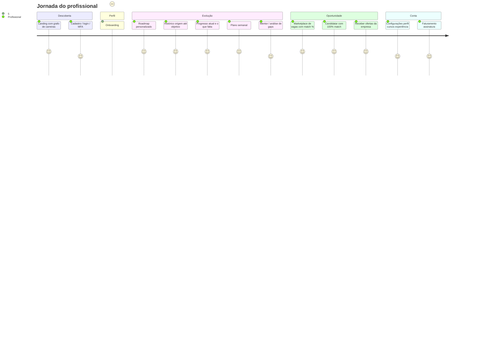

### Empresa (`role: company`)

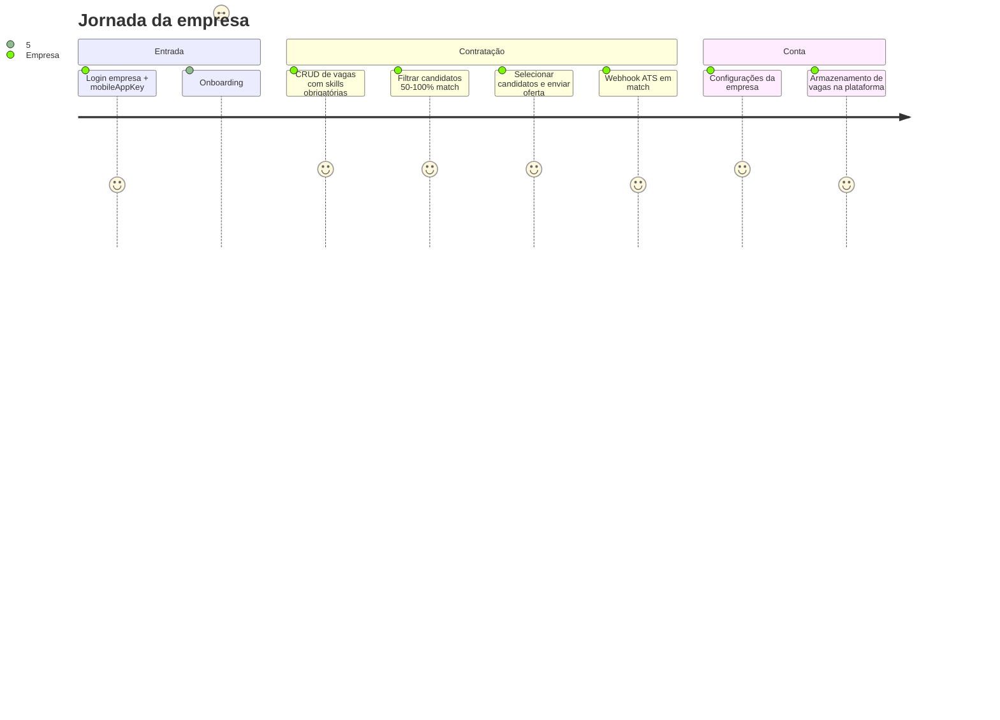

---

## Mapeamento de carreira (profissional)

O núcleo do produto é um **Career Graph**: não apenas uma lista de cursos, mas uma rede de competências onde cada ponto do mapa concentra tudo que o profissional precisa para avançar — e que a empresa pode espelhar ao definir uma vaga.

### Conceitos

| Conceito | Significado no GoRoute |
|----------|------------------------|
| **Nó (skill)** | Unidade do mapa: ex. `kubernetes`, `nestjs`, `sre`. Tem categoria, tier (fase da trilha), descrição, horas estimadas. |
| **Aresta (`REQUIRES`)** | Pré-requisito: para dominar B, recomenda-se dominar A primeiro. Forma o “caminho crítico” até o objetivo. |
| **Estado do nó (cursor)** | Posição do usuário no mapa: `locked` → `available` → `recommended` → `in_progress` → `completed`. Indica o foco atual da jornada. |
| **Skills do perfil** | Inventário do usuário com **nível** (beginner / intermediate / advanced), sincronizado ao grafo Neo4j. |
| **Objetivo (`goalSlug`)** | Skill ou área alvo (ex. `devops`, `fullstack`); o motor calcula caminhos no grafo até esse alvo. |
| **Gap** | Skills no caminho que ainda não estão no nível exigido ou não foram iniciadas/concluídas. |
| **Recursos** | Links curados por nó (docs, vídeos, labs, cursos) no catálogo `career-graph.catalog.ts`. |
| **Projeto** | Desafio prático por nó: título, brief e critérios de aceite — evidência de competência além do autodeclarado. |
| **Time Machine** | ETA até o objetivo: horas restantes, ritmo semanal configurável, % concluído e data estimada (foco no **caminho atual**). |
| **Histórico da jornada** | Linha do tempo: **de onde começou** → marcos concluídos → **onde quer chegar** (pode incluir metas intermediárias). |
| **Progresso em direção ao alvo** | Visão **a partir de hoje**: quanto já avançou no trilho **e o que ainda falta** até o `goalSlug`, mesmo tendo evoluído bastante. |
| **Demanda de mercado** | Score por skill derivado de vagas publicadas; nós “em alta” (`trending`) orientam priorização. |

### O que cada ponto do mapa deve oferecer (requisito de produto)

Para cada nó do roadmap, o usuário deve enxergar de forma unificada:

1. **Skills necessárias** — pré-requisitos satisfeitos ou pendentes, com nível esperado.
2. **Cursor de progresso** — estado visual no grafo e datas de início/conclusão (`node_progress`).
3. **Aprendizado** — recursos e, quando aplicável, **cursos** sugeridos no catálogo.
4. **Habilidades para a vaga** — sobreposição explícita com requisitos de vagas publicadas que usam as mesmas slugs do catálogo (`skill_references`).

### Fluxo de dados (roadmap)

1. Onboarding grava `user_skills` e objetivo em `professional_profiles`.
2. `GraphSyncService` projeta usuário + skills + alvo no **Neo4j** (`User` → `HAS_SKILL` → `Skill`, caminhos `REQUIRES`).
3. `RoadmapService` monta nós/arestas, estados, `recommendedNext`, demand scores e Time Machine.
4. Ações do usuário: `POST /api/roadmap/nodes/:slug/start` e `.../complete` atualizam progresso.
5. `WeeklyPlanService` deriva tarefas da semana a partir do próximo nó recomendado.
6. `POST /api/roadmap/mentor/analyze` resume gaps — **IA opcional** (ver SPEC-03 RF-036):
   - **`off`:** heurística (demand score + estado dos nós), sem LLM;
   - **`managed`:** LLM GoRoute (quota no plano premium, SPEC-11);
   - **`byok`:** credencial do usuário (OpenAI / Gemini / Azure), cifrada em settings (SPEC-10).

### Trilhas exemplificadas no catálogo

- **Full stack:** JavaScript → TypeScript → Angular/React/NestJS → Full Stack.
- **DevOps / SRE:** Git → Linux → Docker → Kubernetes → Terraform/AWS → Observability → SRE.
- **Dados:** Python + SQL → área Data.

O catálogo é extensível e alimenta tanto o Postgres (`skill_references`) quanto o grafo Neo4j.

### Histórico da jornada e progresso em direção ao alvo

O usuário precisa de **duas leituras complementares** — não confundir “quanto já andou na vida” com “o que falta daqui pra frente”.

| Visão | Pergunta que responde | Eixo temporal | Status |
|-------|----------------------|---------------|--------|
| **Histórico** | *De onde eu comecei e como cheguei até aqui?* | Passado → presente → meta final | **Planejado (UI + API)** |
| **Progresso** | *Onde estou agora no caminho até o alvo e o que ainda falta?* | **Ponto atual** → objetivo | **Parcial** (`timeMachine` + estados no grafo) |

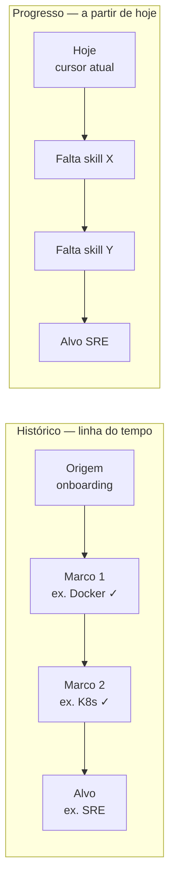

#### Histórico da jornada (origem → marcos → destino)

Mostra a **narrativa completa** da carreira dentro do GoRoute:

1. **Origem (baseline)** — snapshot no fim do onboarding (ou na criação da conta):
   - Data (`journey_started_at`)
   - Skills iniciais + níveis
   - Primeiro `goalSlug` e texto do objetivo (`professional_profiles.goal`)
   - Áreas de interesse
2. **Marcos** — eventos ordenados no tempo:
   - Nó concluído (`roadmap_node_progress.completed_at`)
   - Skill adicionada ou nível aumentado
   - Objetivo alterado (replan) — *“era Full Stack, passou a SRE”*
   - Candidatura ou oferta aceita (opcional, link com vagas)
3. **Destino** — meta atual (`goalSlug` + label do catálogo), mesmo que tenha mudado ao longo do tempo.

**UI planejada:** aba **Histórico** no roadmap (`/dashboard/roadmap/history` ou subaba no grafo):

- Timeline vertical com ícones (início, conclusão, mudança de meta)
- Resumo textual: *“Você começou com 4 skills em mar/2026; hoje tem 12; objetivo: SRE”*
- Comparativo visual **antes/depois** (skills na origem vs. skills hoje)

**API planejada:** `GET /api/roadmap/history`

```json
{
  "origin": {
    "recordedAt": "2026-03-01T10:00:00Z",
    "goalSlug": "frontend",
    "goalLabel": "Frontend",
    "skills": [{ "slug": "javascript", "level": "beginner" }]
  },
  "currentGoal": { "slug": "sre", "label": "SRE", "since": "2026-04-10" },
  "milestones": [
    { "type": "node_completed", "slug": "docker", "label": "Docker", "at": "2026-03-20" },
    { "type": "goal_changed", "from": "frontend", "to": "sre", "at": "2026-04-10" }
  ]
}
```

**Persistência planejada:**

| Tabela | Uso |
|--------|-----|
| `career_journey_snapshots` | Baseline imutável (ou versionada) no onboarding |
| `career_journey_events` | Feed append-only: `node_completed`, `goal_changed`, `skill_level_up`, `application_sent` |
| `roadmap_node_progress` | Já existe — alimenta marcos com datas reais |

#### Progresso em direção ao alvo (a partir do ponto atual)

Responde: *“Já progredi bastante, mas quanto falta **daqui** até o alvo?”*

Separa três métricas no **caminho crítico** (nós `path` + `goal` no grafo, não o catálogo inteiro):

| Métrica | Significado | Fonte atual / alvo |
|---------|-------------|-------------------|
| **% do trilho concluído** | Nós do caminho com `state === completed` / total de nós no caminho | Calcular em `RoadmapService` → `pathProgress.percentNodesDone` |
| **% de esforço (horas)** | Horas feitas / (feitas + restantes) no caminho | `timeMachine.percentDone` *(já existe)* |
| **O que falta** | Lista ordenada: próximo recomendado + nós `locked`/`available` até o alvo | `recommendedNext` + nós com gap |
| **Distância em skills** | Skills no caminho ainda não no perfil ou abaixo do nível desejado | Cruzamento `user_skills` × path |

**Importante:** o usuário pode estar **muito à frente** em skills fora do caminho (ex. já sabe Python) sem isso contar 100% do trilho se o alvo é SRE via DevOps — o progresso mostra honestamente o **delta até o objetivo escolhido**, não um “nível geral” inflado.

**UI planejada:** aba **Progresso** no roadmap (`/dashboard/roadmap/progress` ou painel lateral fixo):

```
┌─────────────────────────────────────────────────────────┐
│  Objetivo: SRE                          [Alterar meta]  │
│  ████████████░░░░░░░░  62% do trilho · 48h restantes    │
│  Hoje: Kubernetes (em progresso) · Próximo: Terraform │
│  Falta para o alvo: 4 skills · ETA ~6 semanas           │
└─────────────────────────────────────────────────────────┘
```

**API planejada:** estender `GET /api/roadmap/me` ou `GET /api/roadmap/progress`:

```json
{
  "goalSlug": "sre",
  "goalLabel": "SRE",
  "pathProgress": {
    "nodesTotal": 13,
    "nodesCompleted": 8,
    "percentNodesDone": 62,
    "currentFocus": { "slug": "kubernetes", "state": "in_progress" },
    "remainingNodes": [
      { "slug": "terraform", "label": "Terraform", "state": "available" }
    ]
  },
  "timeMachine": { "hoursDone": 120, "hoursRemaining": 48, "percentDone": 71, "weeksToGoal": 6 },
  "skillsGapToGoal": [
    { "slug": "terraform", "reason": "not_in_profile" },
    { "slug": "observability", "reason": "prerequisites_pending" }
  ]
}
```

#### Relação entre Histórico, Progresso e Time Machine

| Componente | Histórico | Progresso | Time Machine (hoje) |
|------------|:---------:|:---------:|:---------------------|
| Data de início | Sim (baseline) | Não | Não |
| Marcos passados | Sim | Não | Não |
| Meta final | Sim (pode ter mudado) | Sim (atual) | Sim (`goalSlug`) |
| % concluído | Acumulado desde origem | **No trilho atual** | Horas no grafo exibido |
| O que falta | Opcional (resumo) | **Foco principal** | `hoursRemaining`, `recommendedNext` |
| ETA | Não | Sim | `weeksToGoal`, `estimatedCompletionDate` |

#### Implementação incremental

| Fase | Entrega |
|------|---------|
| **1** | Expor `pathProgress` em `GET /api/roadmap/me`; aba Progresso no frontend com barra + lista “falta” |
| **2** | Snapshot no onboarding + `career_journey_events` + `GET /api/roadmap/history` |
| **3** | Timeline UI; comparativo origem vs. hoje; export PDF “minha jornada” |

---

## Marketplace de talentos (empresa)

### Publicação de vagas

Empresas autenticadas e com onboarding concluído podem:

- Criar, editar, publicar ou arquivar vagas (`job_postings`).
- Definir **skills obrigatórias** com **nível mínimo** por skill (`job_skill_requirements`).
- Opcionalmente configurar `webhookUrl` por vaga ou global na empresa (premium).

### Descoberta e candidatura (profissional)

| Capacidade | Status | Descrição |
|------------|--------|-----------|
| Ver todas as vagas publicadas | **Implementado** | `GET /api/jobs/match` — ordenadas por match %. |
| Filtrar só vagas elegíveis para candidatura | **Planejado** | `?eligibleOnly=true` — exibe só vagas com **100%** match. |
| Ver vagas com match parcial | **Implementado** | Transparência: % + skills faltantes + link ao roadmap. |
| **Candidatar-se** | **Planejado** | Apenas com **100%** match → `POST /api/jobs/:id/apply`. |
| **Ofertas recebidas** | **Planejado** | Área “Oportunidades” quando a empresa seleciona o candidato — ver [Seleção e ofertas](#seleção-de-candidatos-ofertas-e-convites). |

**Princípio (profissional):** pode **explorar** todo o mercado; só **age** (candidatura) quando o perfil comprova 100% dos requisitos.

### Triagem de candidatos (somente empresa)

| Capacidade | Status | Descrição |
|------------|--------|-----------|
| Listar candidatos por faixa de match | **Planejado** | `GET /api/jobs/:id/candidates?minMatch=50` (padrão 100; máx. intervalo **50–100**). |
| Filtro na UI | **Planejado** | Slider ou select: 100%, 80%, 70%, 60%, 50% — **não exposto ao profissional**. |
| Implementação atual | **Parcial** | `GET /api/jobs/:id/match` retorna só **100%** — evoluir para `candidates` com `minMatch`. |
| Selecionar candidato(s) | **Planejado** | `POST /api/jobs/:id/select-candidates` → gera oferta visível ao profissional. |

**Princípio (empresa):** a empresa define o “piso” de match para **descoberta** (50–100%); a **candidatura espontânea** do profissional continua exigindo 100%.

Detalhes: [Motor de matching](#motor-de-matching-filtros-e-candidaturas) · [Workspaces](#workspaces-separados-profissional--empresa).

### Sinal de mercado (feedback loop)

Quando vagas são criadas/atualizadas, slugs das skills incrementam **demand score** no Neo4j (`DemandScoreService`), alimentando o roadmap com skills “trending”. Isso aproxima a plataforma de um **living skills graph** usado em talent marketplaces modernos.

### Integrações

- Evento `job.match.found` dispara webhook HTTP (`X-GoRoute-Event: job.match`) para ATS quando há candidato 100% qualificado.
- Assinatura Stripe libera plano semanal e webhooks avançados (`billing`).

---

## Workspaces separados (profissional × empresa)

Profissional e empresa **não compartilham o mesmo painel**. A sessão carrega `role` (`professional` | `company`); guards no BFF e rotas no Angular impedem cross-access.

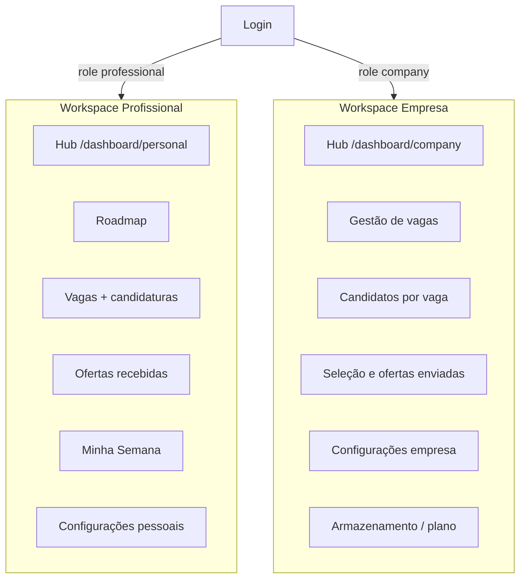

### O que cada role vê (e o que não vê)

| Área | Profissional | Empresa |
|------|:------------:|:-------:|
| Roadmap / grafo pessoal | Sim | Não |
| Histórico da jornada (origem → alvo) | Sim | Não |
| Progresso atual + o que falta até o alvo | Sim | Não |
| Marketplace (todas as vagas + match %) | Sim | Não |
| Candidatar-se a vagas (100%) | Sim | Não |
| Ofertas / convites recebidos | Sim | Não |
| CRUD das **próprias** vagas | Não | Sim |
| Candidatos da vaga (filtro 50–100%) | Não | Sim |
| Selecionar candidatos e enviar oferta | Não | Sim |
| Configurações pessoais (CV, cursos, billing pessoal) | Sim | Não |
| Configurações da empresa (marca, ATS, billing B2B) | Não | Sim |
| Armazenamento de vagas / cotas | Não | Sim |

### Rotas planejadas (frontend)

| Rota | Role | Função |
|------|------|--------|
| `/dashboard/personal` | `professional` | Hub |
| `/dashboard/roadmap` | `professional` | Grafo de carreira |
| `/dashboard/roadmap/history` | `professional` | Linha do tempo: origem → marcos → objetivo *(planejado)* |
| `/dashboard/roadmap/progress` | `professional` | Progresso a partir de hoje + gaps até o alvo *(planejado)* |
| `/dashboard/jobs` | `professional` | Vagas + candidaturas |
| `/dashboard/opportunities` | `professional` | **Ofertas** da empresa (pós-seleção) |
| `/dashboard/weekly-plan` | `professional` | Plano semanal |
| `/dashboard/settings` | `professional` | Configurações (abas abaixo) |
| `/dashboard/company` | `company` | Hub empresa |
| `/dashboard/company/jobs` | `company` | Vagas + candidatos + filtro match |
| `/dashboard/company/offers` | `company` | Ofertas enviadas / pipeline |
| `/dashboard/company/settings` | `company` | Configurações empresa + armazenamento |

**Guards:** `ProfessionalRoleGuard` / `CompanyRoleGuard` (já existem no BFF); replicar no Angular com `canActivate` por role.

---

## Configurações e perfil

O onboarding captura o mínimo para o roadmap. As **Configurações** são o lugar contínuo para enriquecer o perfil — separado por role.

### Profissional — `/dashboard/settings`

| Aba | Conteúdo | Persistência planejada |
|-----|---------|----------------------|
| **Perfil** | Nome, headline, bio, localização, foto, links (LinkedIn, GitHub, portfólio) | `professional_profiles` (+ colunas ou JSON `social_links`) |
| **Experiência profissional** | Lista cronológica: empresa, cargo, período, descrição, skills usadas | `professional_experiences` |
| **Formação e cursos** | Instituição, curso, conclusão, certificado (URL) | `professional_courses` |
| **Skills** | Inventário com nível (além do roadmap); sincroniza com `user_skills` + Neo4j | `user_skills` |
| **Conta e segurança** | E-mail (auth), senha, MFA setup/disable, sessões ativas | `goroute-service-auth` |
| **Faturamento** | Plano Stripe, faturas, método de pagamento (profissional) | `billing` + Stripe Customer |

Dados pessoais sensíveis (documento, telefone) em aba **Dados pessoais** opcional, com consentimento LGPD.

### Empresa — `/dashboard/company/settings`

| Aba | Conteúdo | Persistência planejada |
|-----|---------|----------------------|
| **Empresa** | Razão social, nome fantasia, CNPJ, site, setor, porte, logo | `company_profiles` |
| **Contratação** | Políticas de trabalho, canais de candidatura, localidades | `company_profiles` (campos já iniciados no onboarding) |
| **Equipe e API** | Webhook ATS, API keys B2B, `mobileAppKey` (leitura) | `company_profiles` + `company_api_keys` |
| **Armazenamento de vagas** | Cotas, vagas ativas/arquivadas, uso em MB — ver [Persistência](#persistência-armazenamento-e-ingestão-de-vagas) | `company_storage_usage` |
| **Faturamento** | Plano empresa, vagas incluídas, fatura | Stripe + `company_subscriptions` |

**Regra:** endpoints `GET/PATCH /api/profile/*` (profissional) e `/api/company/settings/*` (empresa) validam `role` — empresa **nunca** lê `professional_experiences` de candidatos exceto via fluxo de candidatura/oferta autorizado.

---

## Seleção de candidatos, ofertas e convites

Fluxo que conecta a triagem da empresa à experiência do profissional.

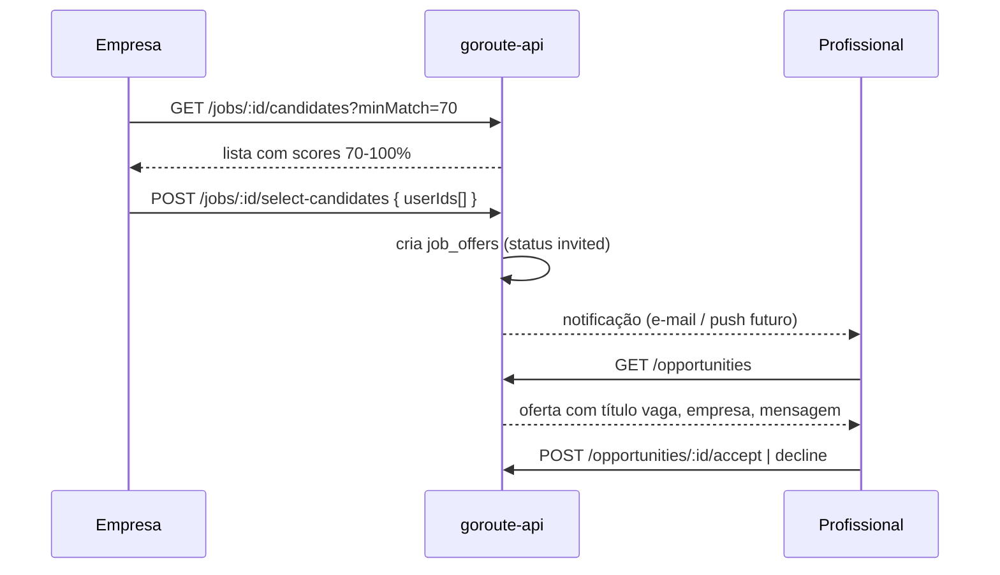

### Estados da oferta (`job_offers`)

| Status | Significado |
|--------|-------------|
| `invited` | Empresa selecionou; profissional ainda não respondeu |
| `viewed` | Profissional abriu a oferta |
| `accepted` | Profissional aceitou seguir no processo |
| `declined` | Profissional recusou |
| `expired` | Prazo encerrado |
| `withdrawn` | Empresa cancelou o convite |

### Diferença: candidatura × oferta

| Conceito | Quem inicia | Match exigido | Onde aparece |
|----------|-------------|---------------|--------------|
| **Candidatura** (`job_applications`) | Profissional | **100%** | Pipeline da empresa + confirmação ao profissional |
| **Oferta / convite** (`job_offers`) | Empresa | Qualquer score na faixa usada na triagem (≥50%) | **`/dashboard/opportunities`** do profissional |

A oferta mostra: título da vaga, nome da empresa, resumo, skills que deram match, mensagem opcional da empresa e CTA (aceitar / recusar / ver detalhe da vaga).

### API planejada (resumo)

| Método | Rota | Role |
|--------|------|------|
| `GET` | `/api/jobs/:id/candidates?minMatch=50` | `company` |
| `POST` | `/api/jobs/:id/select-candidates` | `company` |
| `GET` | `/api/opportunities` | `professional` |
| `GET` | `/api/opportunities/:id` | `professional` |
| `POST` | `/api/opportunities/:id/accept` | `professional` |
| `POST` | `/api/opportunities/:id/decline` | `professional` |
| `GET` | `/api/company/offers` | `company` (ofertas enviadas) |

---

## Identidade, recuperação de senha e MFA

### Recuperação de senha

| Etapa | Implementação | Detalhe |
|-------|---------------|---------|
| Solicitar reset | **Backend pronto** | `POST /goroute-auth/users/password/reset-request` com `{ "email" }`. Rate limit **3/hora por email**. Resposta **sempre genérica** (anti enumeração). |
| Token | **Redis** | Chave `auth:pwd_reset:{token}`, TTL padrão **900 s** (`RESET_TOKEN_TTL`). |
| E-mail | **SMTP** (Nodemailer) | Link `{FRONTEND_URL}/reset-password?token=…` (15 min no texto do e-mail). Requer `SMTP_*` configurado. |
| Concluir reset | **Backend pronto** | `POST /users/password/reset` com `{ "token", "newPassword" }`. Política: ≥8 chars, letra + dígito + símbolo. Revoga **todas** as sessões. |
| UI web | **Planejado** | Hoje existe copy i18n (`FORGOT`) no login, mas **não há rotas** `/forgot-password` e `/reset-password` no Angular — integrar com os endpoints acima. |

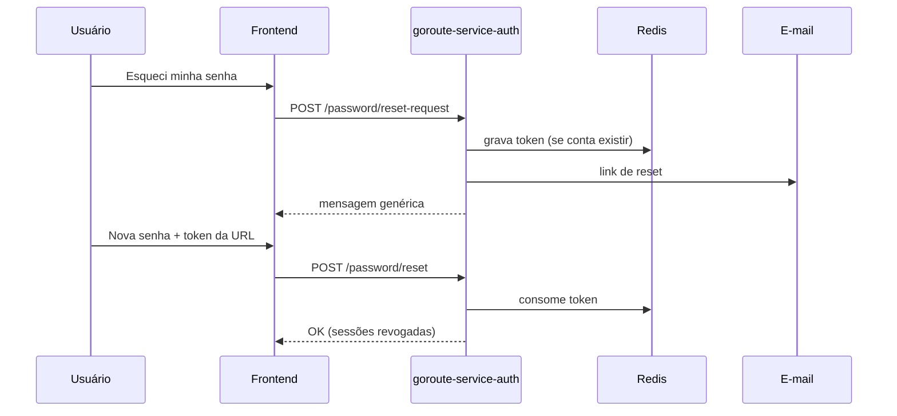

### MFA — qual tecnologia e como ativar?

O GoRoute usa **MFA TOTP (RFC 6238)** — o mesmo padrão de **Google Authenticator**, **Microsoft Authenticator**, **Authy**, **1Password**, etc. **Não** é SMS nem e-mail como segundo fator no login.

| Aspecto | Comportamento |
|---------|---------------|
| Algoritmo | TOTP 6 dígitos, janela de tempo padrão |
| Segredo | Gerado no setup, armazenado **cifrado** (AES-256-GCM, `MFA_SECRET_ENCRYPTION_KEY`) |
| Ativação | Fluxo em 2 passos **autenticado** (ver abaixo) |
| Login com MFA | Após senha correta: `mfaRequired: true` + `tempToken` (Redis, ~300 s) → `/login/mfa` → `POST /users/mfa/verify` |
| Backup | **10 códigos de recuperação** (exibidos **uma vez** no setup); armazenados com hash |
| Desativação | `POST /users/mfa/disable` com código TOTP válido |
| Empresa (web) | Login empresa retorna `mfaRequired: false` fixo hoje — MFA para `company` é **roadmap** |
| OAuth + MFA | **Lacuna MVP:** login social pode emitir sessão completa mesmo com `mfaEnabled` — exige “step-up” futuro |

#### Como o profissional ativa o MFA (passo a passo)

1. Entrar na conta (sessão ativa).
2. `POST /goroute-auth/users/mfa/setup` → resposta com `otpauthUrl`, `qrDataUrl` (QR) e `backupCodesPlain`.
3. Escanear o QR no app autenticador (ou copiar `otpauthUrl`).
4. `POST /users/mfa/confirm` com `{ "code": "123456" }` do app → MFA ativo; e-mail de segurança.
5. Nos logins seguintes: senha → tela MFA → código de 6 dígitos ou backup code.

**UI:** tela de configuração MFA no dashboard profissional está **planejada**; endpoints e domínio já existem em `goroute-service-auth`.

---

## Aplicativo mobile

O repositório atual contém **três apps web/backend**; o **app mobile nativo/híbrido ainda não está neste monorepo**. Ele aparece na arquitetura como cliente separado, pareado por chaves e pelo mesmo serviço de auth.

### Papel do mobile no ecossistema

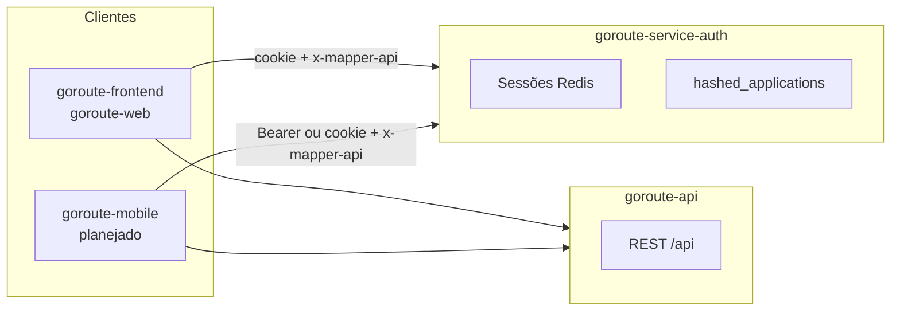

| Função | Web (`goroute-web`) | Mobile (`goroute-mobile` — planejado) |
|--------|---------------------|----------------------------------------|
| Profissional | Roadmap, vagas, plano semanal, MFA | Mesmas APIs; UX mobile-first; notificações push |
| Empresa | CRUD vagas, candidatos | **Emite `mobileAppKey`** para login web da empresa |
| Login empresa web | E-mail + senha + chave copiada do app | App gera/exibe chave rotacionável (`COMPANY_MOBILE_APP_KEY` no servidor) |

### `mobileAppKey` (já implementado no auth)

- Variável de ambiente **`COMPANY_MOBILE_APP_KEY`** no `goroute-service-auth`.
- `POST /companies/login` exige `mobileAppKey` no body quando a variável está definida.
- Objetivo: só dispositivos/automação autorizados da empresa acessam a conta corporativa na web (a chave é obtida no app, não por e-mail).

### Stack sugerida para o app (decisão de arquitetura)

| Opção | Prós | Uso no GoRoute |
|-------|------|----------------|
| **Flutter** ou **React Native** | Um código iOS/Android; OAuth deep links | Candidato: notificações de match, chave empresa |
| **Capacitor** (wrapper do Angular) | Reuso parcial do SPA | MVP rápido com menos features nativas |

**Contrato:** mesmo `X-Application-From: goroute-mobile`, sessão httpOnly ou token de API de longa duração (decisão pendente), e `x-mapper-api` nas chamadas ao BFF.

---

## Motor de matching, filtros e candidaturas

### Algoritmo atual (determinístico, explicável)

Implementação: `goroute-api/src/jobs/job-skill-levels.ts` + `job-match.service.ts`.

**Entradas:**

- **Candidato:** `user_skills[]` com `{ skillSlug, level }`.
- **Vaga:** `job_skill_requirements[]` com `{ skillSlug, minLevel }`.

**Regra de nível** (`meetsMinLevel`):

| Nível | Rank |
|-------|------|
| `beginner` | 1 |
| `intermediate` | 2 |
| `advanced` | 3 |

O candidato atende o requisito se `rank(userLevel) >= rank(minLevel)` e nível > 0.

**Score:**

```
matchScorePercent = round( requisitos_atendidos / total_requisitos * 100 )
```

- Cada requisito pesa igual (**média aritmética**).
- `fullyQualified === (matchScore === 100)`.
- **Profissional** (`findJobsForProfessional`): todas as vagas publicadas, ordenadas por score (inclui parciais).
- **Empresa — hoje:** `findCandidatesForJob` retorna só **100%** (MVP).
- **Empresa — alvo:** `findCandidatesForJob(job, { minMatchPercent })` com `minMatchPercent ∈ [50, 100]`; default **100**; retorna candidatos com `score >= minMatchPercent`, ordenados por score DESC.

**Exemplo:**

| Requisito vaga | Usuário | Conta? |
|----------------|---------|--------|
| `kubernetes` advanced | intermediate | Não |
| `docker` intermediate | advanced | Sim |
| `linux` beginner | intermediate | Sim |

→ **66%** match, `fullyQualified: false`, gaps visíveis no roadmap (mesmas slugs).

### Relação com o mapeamento de carreira

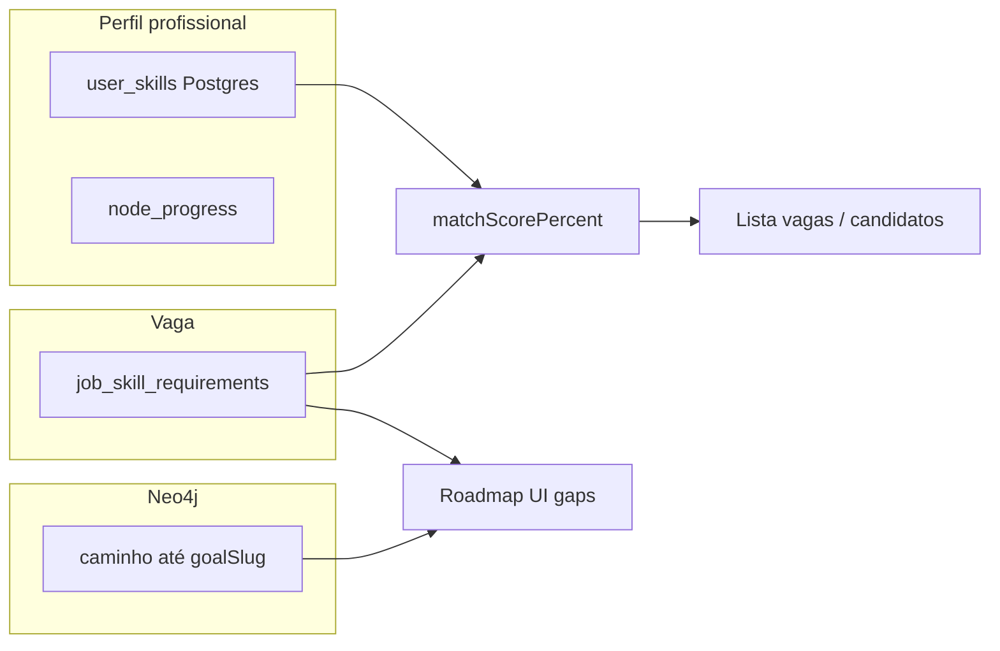

- O **roadmap** responde “o que estudar para chegar ao objetivo”.
- O **match** responde “esta vaga específica está coberta pelo meu inventário atual”.
- Quando a vaga exige skill fora do caminho crítico, o profissional ainda vê a vaga (transparência) e o roadmap pode sugerir nós extras via mentor ou demand score.

### Candidaturas e triagem (regras distintas por role)

| Ação | Quem | Regra |
|------|------|--------|
| Listar vagas | Profissional | Todas; filtro `eligibleOnly=true` → só 100%. |
| Candidatar | Profissional | **Somente** `matchScore === 100` → `POST /api/jobs/:id/apply`. |
| Listar candidatos | **Empresa** | `GET .../candidates?minMatch=50..100` — **exclusivo empresa**. |
| Selecionar / convidar | **Empresa** | Um ou mais `userId` → cria `job_offers` (oferta no painel do profissional). |

**Persistência:**

| Tabela | Uso |
|--------|-----|
| `job_applications` | Candidatura espontânea do profissional (100%). |
| `job_offers` | Convite da empresa após seleção (qualquer score ≥ piso usado na triagem). |
| `job_candidate_selections` | Auditoria: quem selecionou, quando, `minMatch` usado. |

### Evolução do motor (inovação)

| Fase | Método | Quando usar |
|------|--------|-------------|
| **v1 (atual)** | Slug + nível ordinal | Match auditável, baixo custo |
| **v1b (próximo)** | `minMatch` 50–100 só empresa | Triagem flexível sem afrouxar candidatura |
| **v2** | Peso obrigatório vs. desejável | Vagas com “nice to have” |
| **v3** | Embeddings + ESCO | Texto livre → slugs |
| **v4** | Webhook em faixas (≥80%, ≥100%) | `MATCH_WEBHOOK_THRESHOLD = 80` já no código para eventos |

---

## Persistência, armazenamento e ingestão de vagas

### Onde as vagas ficam guardadas?

**Sempre no banco PostgreSQL da plataforma** (BFF) — é o armazenamento oficial. Não há vagas em arquivo JSON/CSV em produção (import é apenas canal de entrada).

| Tabela | Conteúdo |
|--------|----------|
| `job_postings` | Metadados + `description` (texto), `status`, `storage_tier`, `archived_at`, `bytes_estimate` |
| `job_skill_requirements` | Skills estruturadas por vaga |

Vagas ocupam espaço (título, descrição longa, histórico, candidatos, ofertas). Por isso existe **gestão de armazenamento** no painel empresa.

### Armazenamento na plataforma (cotas e ciclo de vida)

| Conceito | Descrição |
|----------|-----------|
| **Armazenamento ativo** | Vagas `published` ou `draft` contam na cota da empresa. |
| **Arquivar** | `status: archived` — sai do marketplace; permanece no banco para histórico/ATS; **reduz** “vagas ativas” da cota. |
| **Excluir** | Soft-delete (`deleted_at`) após período de retenção ou a pedido (LGPD/contrato). |
| **Cota por plano** | Ex.: Starter 10 vagas ativas / 50 MB; Pro 100 vagas / 500 MB — ligado ao Stripe. |
| **Métricas** | `company_storage_usage`: `active_jobs`, `archived_jobs`, `total_bytes`, `applications_count`. |

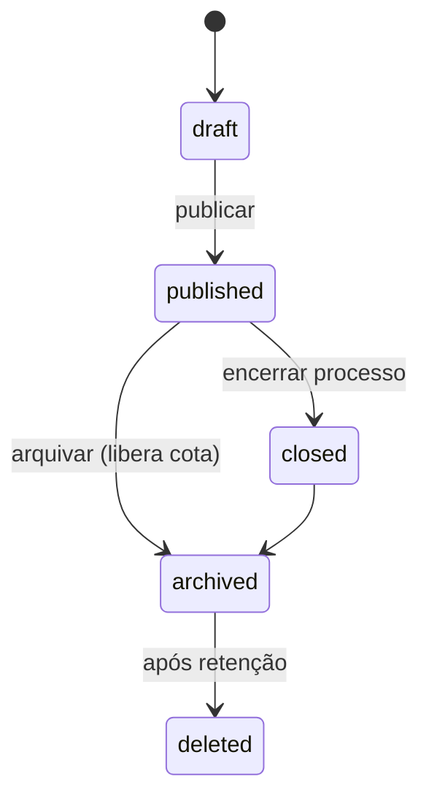

**UI empresa** (`/dashboard/company/settings` → Armazenamento): barras de uso, botão “Arquivar” por vaga, alerta ao atingir 80% da cota, upsell de plano.

**API:** `GET /api/company/storage` · `POST /api/jobs/:id/archive` · `DELETE /api/jobs/:id` (soft) — role `company` only.

Arquivos estáticos (logos) → object storage (S3/R2) referenciado por URL em `company_profiles.logo_url`; o **conteúdo da vaga** fica no Postgres.

### Canais de criação de vagas

| Canal | Status | Descrição |
|-------|--------|-----------|
| **UI web** (`CompanyJobs`) | Implementado | Formulário → `POST /api/jobs` |
| **API B2B** | Planejado | `POST /api/v1/company/jobs` com API key — ver [API B2B](#api-de-integração-b2b-empresas) |
| **Import em lote** | Planejado | CSV/JSON assíncrono + validação de slugs |
| **IA (assistida)** | Planejado | Colar descrição → extrator de skills (ESCO/Nesta) → revisão humana → salvar |

### Ingestão de vagas externas (mercado)

Não há scraping automático no MVP. Estratégia recomendada:

1. **Cadastro manual / API** — fonte de verdade para vagas da plataforma GoRoute.
2. **Pipeline opcional (futuro):** job board partners → fila (SQS/Redis) → worker normaliza título/descrição → IA extrai skills → humano ou regra auto-publica se confiança > limiar.
3. **Benchmark apenas:** vagas externas alimentam **demand scores** sem duplicar postagens (anonimizar empresa).

**Princípio:** nunca gravar vaga sem `skill_slug` validado em `skill_references` (evita grafo quebrado).

---

## Sincronização de skills e catálogo

### Fonte canônica (single source of truth)

```text
career-graph.catalog.ts  →  seed/upsert  →  skill_references (Postgres)
                         →  sync Neo4j   →  Skill nodes + REQUIRES edges
```

### Eventos que disparam sincronização

| Evento | Postgres | Neo4j | Redis demand |
|--------|----------|-------|--------------|
| Onboarding complete | `user_skills`, `professional_profiles.goal` | `GraphSyncService.syncProfessionalUser` | — |
| Concluir nó roadmap | upsert `user_skills` se ausente | re-sync HAS_SKILL | — |
| Weekly plan recalculate | — | unlock path Cypher | — |
| Criar/atualizar vaga | `job_skill_requirements` | increment `demand_score` | cache scores |
| Admin adiciona skill ao catálogo | upsert `skill_references` | MERGE Skill + edges | — |

### Normalização de slugs

`skill-slug.util.ts`: lowercase, sem acentos, hífens — garante que onboarding, vagas e catálogo usem o **mesmo identificador**.

### Skills desconhecidas

- Onboarding/vaga com slug fora do catálogo → `400 INVALID_SKILL_REFERENCE`.
- **Futuro:** fila de “skill proposals” para curadoria; após aprovação, entra no catálogo e migração associa vagas pendentes.

### Sincronização com taxonomias externas (roadmap)

| Fonte | Uso |
|-------|-----|
| **ESCO** | Mapear ocupações e skills; import batch |
| **O*NET** | Crosswalk EU/US para cargos internacionais |
| **IA** | Sugerir slug a partir de texto; humano confirma |

---

## Grafo pessoal, progressão e replanejamento

### Onde fica o grafo de cada usuário?

É **distribuído por camada** — cada store tem um papel:

| Camada | O quê | Exemplo |
|--------|-------|---------|
| **Postgres** | Estado durável e consultas de negócio | `user_skills`, `node_progress`, `professional_profiles.goal`, `weekly_plans` |
| **Neo4j** | Caminhos, pré-requisitos, demanda, projeção para algoritmos de grafo | `(:User)-[:HAS_SKILL]->(:Skill)`, `[:TARGETS]`, `[:REQUIRES]*`, `shortestPath` até objetivo |
| **Catálogo (código)** | Definição global de trilhas (igual para todos) | `CATALOG_NODES`, `CATALOG_EDGES` |
| **Frontend** | Visualização `vis-network` | `/dashboard/roadmap`, landing pública |

O grafo **pessoal** = catálogo global **filtrado e anotado** com estado do usuário (`completed`, `in_progress`, …) + caminho calculado até `goalSlug`.

### Como o usuário progride?

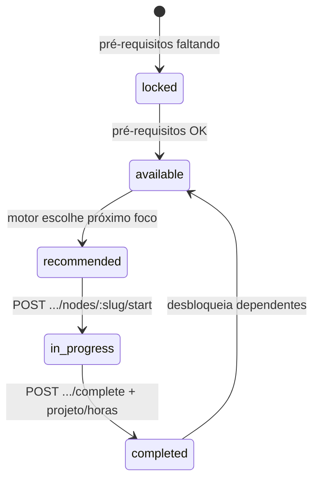

1. **Onboarding** — declara skills iniciais + objetivo textual → `resolveTargetSkillSlug` escolhe `goalSlug`.
2. **Roadmap** — calcula shortest path no Neo4j; destaca `recommendedNext`.
3. **Plano semanal** — tarefas derivadas do nó foco.
4. **Concluir nó** — grava `roadmap_node_progress`, pode criar `user_skill`, re-sincroniza Neo4j, recalcula semana; gera marco no **histórico** (planejado).
5. **Progresso** — painel “daqui até o alvo”: % do trilho, nó atual, lista do que falta ([detalhe](#histórico-da-jornada-e-progresso-em-direção-ao-alvo)).
6. **Vagas** — match sobe conforme skills sobem de nível ou novas skills entram no perfil.

### Replanejar: mudar objetivo ou inserir profissão no meio do caminho

**Hoje:** objetivo é definido no onboarding (`professional_profiles.goal` + `TARGETS` no Neo4j). **Não há** endpoint público `PATCH /api/profile/goal` ainda.

**Comportamento planejado** (`POST /api/roadmap/replan` ou `PATCH /api/profile/career-goal`):

| Cenário | Comportamento |
|---------|---------------|
| Mudar profissão alvo (ex. Frontend → DevOps) | Novo `goalSlug`; recalcula caminho; nós `completed` **permanecem** (histórico); nós só do trilho antigo ficam `archived` opcional na UI |
| Inserir “profissão intermediária” | Novo waypoint: ex. objetivo era `sre`, usuário adiciona etapa `devops` — grafo passa por sub-objetivo antes do alvo final |
| Pivot lateral | Mesmo tier, outra branch (React → Angular): preserva skills compartilhadas (`typescript`), recalcula só subárvore |

**Algoritmo de replanejamento:**

1. Validar `newGoalSlug` no catálogo.
2. Atualizar Postgres + `GraphSyncService` (`TARGETS`).
3. Recalcular paths Neo4j; não apagar `node_progress` sem confirmação explícita.
4. Invalidar/recalcular `weekly_plan` e notificar mudança de ETA (Time Machine).

---

## API de integração B2B (empresas)

Empresas devem operar **pela plataforma web e por API** com o mesmo modelo de dados.

### Autenticação da API

| Mecanismo | Uso |
|-----------|-----|
| **API Key** por empresa | Header `Authorization: Bearer gr_company_…` ou `X-GoRoute-Api-Key` |
| **Escopo** | `jobs:write`, `jobs:read`, `candidates:read`, `webhooks:manage` |
| **Rate limit** | Por key + IP (Redis) |

Alternativa: OAuth2 client credentials por `company_user_id` (fase enterprise).

### Modelo de comunicação (REST + eventos)

**Base URL:** `https://api.goroute.app/api/v1/company` (prefixo versionado planejado).

#### Criar vaga (exemplo)

```http
POST /v1/company/jobs
Authorization: Bearer gr_company_***
Content-Type: application/json
Idempotency-Key: 7c9e6679-7425-40de-944b-e07fc1f90ae7

{
  "title": "Engenheiro DevOps Pleno",
  "description": "… texto livre …",
  "status": "published",
  "skills": [
    { "slug": "kubernetes", "minLevel": "intermediate" },
    { "slug": "terraform", "minLevel": "beginner" }
  ],
  "externalId": "ats-8821",
  "webhookUrl": "https://ats.empresa.com/hooks/goroute"
}
```

**Resposta:** `201` + `{ "id", "matchPreviewUrl", "skills": [...] }`.

#### Contexto de erro (padrão)

```json
{
  "code": "INVALID_SKILL_REFERENCE",
  "message": "One or more skills are not in the reference catalog.",
  "invalidSlugs": ["k8s"],
  "hint": "Use GET /v1/skills?q=kubernetes"
}
```

#### Webhooks (empresa recebe)

| Evento | Payload resumido |
|--------|------------------|
| `job.candidate.matched` | `jobId`, `candidate` (userId, matchScore, matchedSkills) |
| `job.application.received` | Quando profissional candidata (futuro) |
| `job.published` | Confirmação de publicação via API |

Assinatura HMAC: header `X-GoRoute-Signature` (sha256 do body + secret da empresa).

### Paridade UI ↔ API

Toda ação do painel `CompanyJobs` deve ter equivalente REST documentado no OpenAPI (`/api/docs`), evitando “API de segunda classe”.

---

## Capacidades inovadoras (roadmap)

Funcionalidades para tornar a plataforma **mais rica e atual**, além do MVP:

| Ideia | Benefício |
|-------|-----------|
| **Career Twin** | Simular “e se eu mudar para X?” comparando ETAs e gaps sem alterar o grafo até confirmar |
| **Heatmap de mercado** | Mapa global de skills por região/setor a partir de vagas agregadas |
| **Match narrativo (IA)** | Mentor explica em linguagem natural por que 66% e quais 2 nós do roadmap fecham o gap |
| **Prova de skill** | Upload/link de projeto Git; reviewer ou CI badge sobe nível automaticamente |
| **Trilhas por empresa** | Empresa publica “nossa stack” como template; candidatos alinham roadmap ao employer branding |
| **Mobilidade interna** | Mesmo motor para projetos internos/gigs (não só vagas externas) |
| **Notificações** | Push mobile quando vaga 100% match ou skill entra em trending |
| **Fairness dashboard** | Métricas de viés no matching (skills-proxy, diversidade de shortlist) |
| **Integração LMS** | Concluir curso Coursera/Udemy marca nó como `in_progress` via webhook |
| **Open API público de skills** | `GET /api/v1/skills` read-only para parceiros |

---

## Práticas de mercado e referências

A visão do GoRoute alinha-se a tendências consolidadas em 2025–2026 (career pathing, talent marketplace, skills-based hiring):

| Prática | Como o GoRoute endereça | Evolução planejada |
|---------|-------------------------|-------------------|
| **Inventário de skills + gap analysis** | Perfil + grafo + mentor/gaps | Validação por gestor/certificação |
| **Career paths explícitos (vertical/lateral)** | Arestas `REQUIRES` e múltiplas trilhas no catálogo | Paths por cargo (templates ESCO/O*NET) |
| **Living skills graph** | Neo4j + demand scores de vagas reais | Ingestão de OJA / APIs externas |
| **Talent marketplace** | Vagas + match bidirecional | Projetos internos, gigs, mobilidade |
| **Explainable matching** | % match + lista de skills atendidas | Embeddings semânticos (ESCO) |
| **Planos de desenvolvimento ligados ao gap** | Weekly plan + recursos/projeto por nó | Integração LMS |
| **Governança e confiança** | Catálogo canônico, slugs validados | Auditoria, anti-viés em matching |

**Referências externas (pesquisa e open source):**

- [Career mapping / gap analysis (iMocha, 2026)](https://www.imocha.io/blog/career-mapping) — inventário, gaps, trilhas dinâmicas.
- [TalentGuard Career Pathing](https://www.talentguard.com/platform/career-pathing) — readiness por role, atividades ligadas ao gap.
- [Talent marketplace (Joveo, 2026)](https://www.joveo.com/talent-marketplace-ultimate-guide/) — perfis skills-first e matching.
- [ESCO ↔ O*NET crosswalk](https://esco.ec.europa.eu/en/about-esco/data-science-and-esco/crosswalk-between-esco-and-onet) — interoperabilidade de ocupações.
- [SkillAlign (GitHub)](https://github.com/Y4SSERk/SkillAlign) — grafo ESCO + Neo4j + matching semântico.
- [ojd_daps_skills (Nesta)](https://github.com/nestauk/ojd_daps_skills) — extração de skills de textos de vaga.

---

## Arquitetura do sistema

### Diagrama lógico

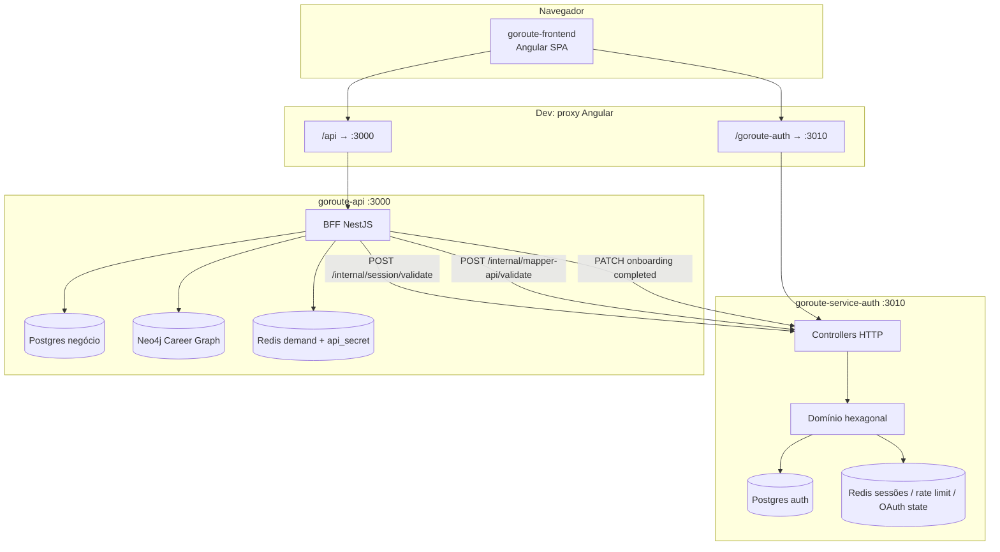

### Papéis de cada serviço

#### 1. `goroute-frontend` (SPA)

- **Responsabilidade:** interface do usuário, i18n, landing com grafo de carreiras (`vis-network`), auth, onboarding, **roadmap interativo**, **marketplace de vagas**, **plano semanal**, pricing/Stripe.
- **Comunicação:**
  - Chamadas **diretas** ao serviço de auth em `/goroute-auth` (login, registro, MFA).
  - Chamadas ao **BFF** em `/api` para `/me`, onboarding e dashboard (com `credentials: include` e header `x-mapper-api`).
- **Deploy:** preparado para Vercel (`vercel.json` presente); build com script de hardening do `dist`.

#### 2. `goroute-service-auth` (microsserviço de autenticação)

- **Responsabilidade:** identidade, sessões, MFA, OAuth, reset de senha, validação interna para outros serviços.
- **Arquitetura:** **hexagonal** — domínio puro em `src/domain/`, adaptadores em `src/infrastructure/`.
- **Persistência:** PostgreSQL (usuários, empresas, contas sociais, MFA, hashes de aplicação “mapper”).
- **Cache / estado:** Redis (sessões, rate limiting, tokens temporários MFA, reset de senha, estado OAuth/PKCE).
- **Porta padrão em dev:** `3010` (proxy do frontend).

#### 3. `goroute-api` (BFF de negócio)

- **Responsabilidade:** perfis, **roadmap** (Neo4j + catálogo), **vagas e matching**, **plano semanal**, demand scores, **billing** Stripe, onboarding, `/me`, dashboard.
- **Arquitetura:** NestJS modular (não hexagonal); atua como **Backend for Frontend**.
- **Persistência:** PostgreSQL separado do auth (`GOROUTE_DATABASE_URL` / `DATABASE_URL`).
- **Redis:** rotação automática de segredo `api_secret_key` (uso futuro / integração; chave `gr_sk_…` a cada 24h).
- **Prefixo global:** `/api` (Swagger em `/api/docs`).
- **Porta padrão:** `3000`.

### Por que BFF + Auth separados?

- O **auth** concentra políticas sensíveis (senha, MFA, cookies, OAuth) e expõe apenas endpoints internos com `INTERNAL_API_KEY`.
- O **BFF** nunca confia só no cookie: exige também o header **`x-mapper-api`**, hash emitido no login e validado no auth contra a tabela de aplicações pareadas (`applicationFrom`, ex.: `goroute-web`). Isso amarra a sessão ao contexto da aplicação cliente (web vs. app mobile no fluxo empresa).
- Perfis de negócio (bio, skills, dados da empresa) ficam no Postgres do BFF; flags `onboardingCompleted` ficam no Postgres do auth e são sincronizadas via `PATCH /internal/users/:id/onboarding` ou `.../companies/:id/onboarding`.

### Dois tipos de conta (roles)

| Role | `subjectType` no auth | Login no frontend | Onboarding |
|------|----------------------|-------------------|------------|
| `professional` | `user` | `/login` → `POST /users/login` | Perfil pessoal, áreas, skills com nível, objetivo |
| `company` | `company` | `/login/empresa` → `POST /companies/login` (+ `mobileAppKey`) | Dados da empresa, contratação, skills prioritárias |

---

## Estrutura do repositório

```text
GoRoute/
├── PROJETO.md                 ← este arquivo
├── goroute-frontend/          ← Angular 21 SPA
│   ├── src/app/
│   │   ├── core/              ← HTTP, auth, onboarding API, guards, i18n, tema, CSP
│   │   ├── pages/             ← home, about, login, onboarding, dashboard
│   │   └── components/        ← side-menu, footer
│   ├── public/i18n/           ← pt-BR, en, es, de
│   └── proxy.conf.json        ← dev: auth :3010, api :3000
├── goroute-api/               ← NestJS BFF
│   └── src/
│       ├── auth/              ← validação sessão + mapper, guards
│       ├── onboarding/        ← schema, complete, skip
│       ├── roadmap/           ← grafo, progresso, mentor
│       ├── weekly-plan/       ← plano semanal gamificado
│       ├── jobs/              ← vagas, matching, webhooks
│       ├── jobs-market/       ← demand scores (Neo4j + Redis)
│       ├── billing/           ← Stripe checkout + premium guards
│       ├── dashboard/         ← summary protegido
│       ├── database/          ← TypeORM, Neo4j, seed do catálogo
│       ├── api-secret/        ← rotação Redis
│       └── redis/
└── goroute-service-auth/      ← NestJS auth hexagonal
    └── src/
        ├── domain/            ← entities, ports, use-cases
        └── infrastructure/    ← TypeORM, Redis, OAuth, controllers
```

---

## Fluxos principais

### 1. Registro e login (profissional)

1. Usuário acessa `/login` ou `/login/register`.
2. Frontend chama `POST /goroute-auth/users/register` ou `POST /users/login` com header `X-Application-From: goroute-web`.
3. Auth valida credenciais, aplica rate limit (Redis), opcionalmente exige MFA (`mfaRequired` + `tempToken`).
4. Se sessão completa: cookie httpOnly + resposta pode incluir header **`x-mapper-api`** (hash).
5. Frontend persiste o hash via `GorouteMapperApiContextService` (sessionStorage).
6. `PostAuthNavigationService` redireciona para `/onboarding` ou dashboard conforme `onboardingCompleted`.

### 2. Login empresa

1. Rota `/login/empresa`.
2. `POST /companies/login` com `email`, `password` e **`mobileAppKey`** (pareamento com app mobile).
3. Mesmo mecanismo de cookie + `x-mapper-api` quando aplicável.
4. MFA não é exposto neste fluxo no controller de empresas (`mfaRequired: false` fixo no retorno atual).

### 3. MFA (profissional)

**Ativação (conta já logada):** `POST /users/mfa/setup` → QR no app autenticador → `POST /users/mfa/confirm` com primeiro código.

**Login:** após senha com MFA ativo:

1. Resposta `mfaRequired: true` + `tempToken` → `/login/mfa`.
2. `POST /users/mfa/verify` com código TOTP de 6 dígitos ou backup code.
3. Cookie de sessão + possível novo `x-mapper-api`.

### 3b. Recuperação de senha

1. `POST /users/password/reset-request` com e-mail.
2. Utilizador abre link do e-mail (`/reset-password?token=…`) — UI planejada.
3. `POST /users/password/reset` com nova senha; todas as sessões revogadas.

### 4. Chamadas ao BFF

1. Interceptor `withCredentialsInterceptor` envia cookies nas requisições `/api`.
2. Interceptor `mapperApiHeaderInterceptor` anexa `x-mapper-api` quando há hash salvo.
3. `SessionAuthGuard` no BFF:
   - Valida hash em `POST /internal/mapper-api/validate`.
   - Valida sessão em `POST /internal/session/validate`.
   - Garante `mapper.userId === session.user.id`.
4. Rotas de onboarding usam só `SessionAuthGuard`.
5. Dashboard exige também `OnboardingCompletedGuard` (`onboardingCompleted === true`).

### 5. Onboarding completo

1. `GET /api/onboarding/schema` — devolve passos/campos conforme role.
2. `POST /api/onboarding/complete` — valida DTO, grava perfil + skills em transação no Postgres do BFF.
3. BFF chama auth: `PATCH /internal/users/:userId/onboarding` ou `.../companies/:companyId/onboarding`.
4. Skills/tags devem existir em `skill_references` (seed na primeira subida); senão `INVALID_SKILL_REFERENCE`.

### 6. Pular onboarding

- `POST /api/onboarding/skip` — marca onboarding como concluído no auth **sem** persistir perfil de negócio.

### 7. Roadmap e evolução de skills

1. Após onboarding, o perfil sincroniza skills e objetivo no Neo4j.
2. `GET /api/roadmap/me` — grafo completo com estados, demanda e Time Machine.
3. `GET /api/roadmap/nodes/:slug` — detalhe: pré-requisitos, recursos, projeto, notas.
4. Usuário inicia/conclui nós; plano semanal é recalculado a partir do próximo recomendado.

### 8. Vagas e matching

1. Empresa cria vaga com skills + `minLevel`; publica (`status: published`).
2. Profissional consulta `GET /api/jobs/match` — vagas ordenadas por fit.
3. Empresa consulta `GET /api/jobs/:id/match` — candidatos 100% qualificados; webhook se configurado.

### 9. Assinatura (Stripe)

1. `GET /api/billing/plans` — planos disponíveis.
2. `POST /api/billing/checkout` — Hosted Checkout; features premium (plano semanal, webhooks) liberadas após sync.

---

## O que já foi implementado

### Infraestrutura e integração

- [x] Três serviços com responsabilidades separadas (SPA, auth, BFF).
- [x] Proxy de desenvolvimento no Angular (`/goroute-auth`, `/api`).
- [x] CORS com `credentials: true` no BFF e no auth.
- [x] Swagger no BFF (`/api/docs`).
- [x] Validação global com `class-validator` / `ValidationPipe` (whitelist).
- [x] Comunicação BFF ↔ auth via `INTERNAL_API_KEY` e endpoints `/internal/*`.
- [x] Docker Compose no auth (Postgres 16 + Redis 7; serviço auth comentado no compose).

### Autenticação e segurança (`goroute-service-auth`)

- [x] Arquitetura hexagonal (domínio, ports, use cases, adapters).
- [x] Registro e login de **usuário** (`/users/*`).
- [x] Registro e login de **empresa** (`/companies/*`) com validação de `mobileAppKey`.
- [x] Sessões stateful no Redis (TTL por inatividade + limite absoluto).
- [x] Cookies httpOnly configuráveis (`SESSION_COOKIE_NAME`, `COOKIE_SECURE`, domínio).
- [x] MFA TOTP: setup, confirm, disable, verify pós-login com backup codes.
- [x] Recuperação de senha (token Redis, rate limit, revogação de sessões).
- [x] OAuth Google, GitHub, Microsoft, Facebook, Discord (login, link, unlink, callbacks). Apple **não implementado** (ver SEC-DOC-01).
- [x] Rate limiting Redis (login, reset, MFA verify).
- [x] Endpoint interno `POST /internal/session/validate`.
- [x] Endpoint interno `POST /internal/mapper-api/validate`.
- [x] Patch interno de onboarding para user e company.
- [x] Emissão de header `x-mapper-api` no login (quando há hash associado).
- [x] Health check.
- [x] Auditoria via logger em eventos de segurança.
- [x] Testes unitários de exemplo (ex.: `RegisterUserUseCase`).

### Negócio e perfis (`goroute-api`)

- [x] Módulo global de auth BFF (`AuthSessionService`, `AuthMapperService`, `AuthInternalService`).
- [x] Guards `SessionAuthGuard`, `OnboardingCompletedGuard`, `ProfessionalRoleGuard`, `CompanyRoleGuard`, `PremiumFeatureGuard`.
- [x] `GET /api/me`, `GET /api/health`.
- [x] Onboarding: schema dinâmico, complete (profissional/empresa), skip.
- [x] Entidades: perfis, `user_skills`, `company_skills`, `skill_references`, `job_postings`, `job_skill_requirements`, `node_progress`, `weekly_plans`.
- [x] Seed/upsert do catálogo a partir de `career-graph.catalog.ts` (dezenas de skills e trilhas).
- [x] **Neo4j:** sincronização de usuário/skills/objetivo; relações `REQUIRES`; demand scores.
- [x] **Roadmap:** grafo personalizado, estados de nó, Time Machine, mentor (hoje: Gemini global ou heurística; **planejado:** off / managed / BYOK — SPEC-03 v3.1).
- [x] **Weekly plan:** tarefas semanais derivadas do roadmap; complete/skip/recalculate.
- [x] **Jobs:** CRUD empresa, listagem, match profissional e candidatos 100% para empresa.
- [x] **Webhooks** ATS em match (`job-webhook.listener`).
- [x] **Billing** Stripe: plans, checkout, subscription sync, features premium.
- [x] `GET /api/dashboard/summary`.
- [x] Rotação agendada de `api_secret_key` em Redis.

### Frontend (`goroute-frontend`)

- [x] Angular 21 standalone, lazy routes.
- [x] Landing **Home** com grafo de carreiras (`vis-network`).
- [x] Login, registro, MFA, login empresa.
- [x] Onboarding profissional e empresa.
- [x] Hub **dashboard pessoal** com atalhos: roadmap, vagas, semana, pricing.
- [x] **Dashboard roadmap** — visualização do grafo do usuário.
- [x] **Jobs marketplace** — vagas com match para profissionais.
- [x] **Company jobs** — gestão de vagas para empresas.
- [x] **Weekly plan** — plano semanal gamificado.
- [x] Página **Pricing** / Stripe.
- [x] Dashboard empresa (hub contratação).
- [x] i18n (`pt-BR`, `en`, `es`, `de`), tema claro/escuro, interceptors, CSP, hardening de build.

---

## Funcionalidades por camada

### Frontend — páginas e rotas

| Rota | Componente | Função |
|------|------------|--------|
| `/` | `Home` | Landing marketing + grafo de carreiras em tela cheia |
| `/about` | `About` | Sobre o produto |
| `/login` | `LoginSignIn` | Login profissional |
| `/login/empresa` | `LoginCompany` | Login empresa + chave do app mobile |
| `/login/register` | `LoginRegister` | Cadastro profissional ou empresa |
| `/login/mfa` | `LoginMfa` | Segundo fator após login |
| `/onboarding` | `Onboarding` | Wizard de perfil (ou redirect se já concluído) |
| `/dashboard/personal` | `DashboardPersonal` | Hub profissional (roadmap, vagas, semana) |
| `/dashboard/roadmap` | `DashboardRoadmap` | Grafo de carreira interativo |
| `/dashboard/roadmap/history` | *(planejado)* | Timeline da jornada |
| `/dashboard/roadmap/progress` | *(planejado)* | Progresso atual + falta até o alvo |
| `/dashboard/jobs` | `JobsMarketplace` | Vagas + candidatura (100%) |
| `/dashboard/opportunities` | *(planejado)* | Ofertas enviadas pela empresa |
| `/dashboard/settings` | *(planejado)* | Perfil, experiência, cursos, billing |
| `/dashboard/weekly-plan` | `WeeklyPlan` | Plano semanal executável |
| `/dashboard/company` | `DashboardCompany` | Hub empresa |
| `/dashboard/company/jobs` | `CompanyJobs` | CRUD, candidatos (filtro 50–100%), seleção |
| `/dashboard/company/offers` | *(planejado)* | Ofertas enviadas |
| `/dashboard/company/settings` | *(planejado)* | Empresa, API, armazenamento, billing |
| `/pricing` | `Pricing` | Planos e checkout Stripe |

### Frontend — serviços core

| Serviço | Responsabilidade |
|---------|------------------|
| `GorouteAuthApiService` | Login, registro, MFA verify → auth service |
| `GorouteRestApiService` | `GET /api/me` |
| `GorouteOnboardingApiService` | Schema, complete, skip → BFF |
| `GorouteMapperApiContextService` | Persistência do hash `x-mapper-api` |
| `LoginFlowService` | Estado temporário do fluxo MFA |
| `PostAuthNavigationService` | Redirecionamento pós-login/onboarding |
| `I18nService` / `ThemeService` | Idioma e aparência |

### Auth — endpoints públicos (resumo)

**Usuários (`/users`):** register, login, logout, logout/all, me, MFA (setup, confirm, disable, verify), password reset, unlink social.

**Empresas (`/companies`):** register, login.

**OAuth (`/auth/*`, `/social/*`):** login/link/callback Google, GitHub, Microsoft, Facebook, Discord; unlink. Apple não implementado.

**Interno (`/internal`, API key):** session validate, mapper-api validate, patch onboarding user/company.

Documentação completa dos endpoints: `goroute-service-auth/README.md`.

### BFF — endpoints (resumo)

| Método | Rota | Auth | Descrição |
|--------|------|------|-----------|
| `GET` | `/api/health` | Não | Health check |
| `GET` | `/api/me` | Sessão + mapper | Usuário autenticado |
| `GET` | `/api/onboarding/schema` | Sessão + mapper | Passos do wizard |
| `POST` | `/api/onboarding/complete` | Sessão + mapper | Salva perfil e marca onboarding no auth |
| `POST` | `/api/onboarding/skip` | Sessão + mapper | Marca onboarding sem perfil |
| `GET` | `/api/dashboard/summary` | Sessão + mapper + onboarding | Resumo do dashboard |
| `GET` | `/api/roadmap/me` | Sessão + mapper + onboarding | Grafo + Time Machine *(evoluir: `pathProgress`)* |
| `GET` | `/api/roadmap/progress` | Idem | Progresso atual e gaps até o alvo *(planejado)* |
| `GET` | `/api/roadmap/history` | Idem | Histórico origem → marcos → meta *(planejado)* |
| `GET` | `/api/roadmap/nodes/:slug` | Idem | Detalhe do nó (skills, recursos, projeto) |
| `POST` | `/api/roadmap/nodes/:slug/start` | Idem | Inicia progresso no nó |
| `POST` | `/api/roadmap/nodes/:slug/complete` | Idem | Conclui nó |
| `POST` | `/api/roadmap/mentor/analyze` | Idem | Análise de gaps / próximo desafio |
| `GET` | `/api/weekly-plan` | Idem (+ premium p/ algumas ações) | Plano da semana atual |
| `POST` | `/api/weekly-plan/tasks/:id/complete` | Idem | Conclui tarefa |
| `POST` | `/api/weekly-plan/recalculate` | Idem | Recalcula plano a partir do roadmap |
| `GET` | `/api/jobs` | Idem | Lista vagas (por role) |
| `GET` | `/api/jobs/match` | Profissional | Vagas com % match |
| `POST` | `/api/jobs` | Empresa | Cria vaga |
| `GET` | `/api/jobs/:id/match` | Empresa | Candidatos 100% *(evoluir → `/candidates?minMatch`)* |
| `GET` | `/api/jobs/:id/candidates?minMatch=50-100` | Empresa | Triagem configurável *(planejado)* |
| `POST` | `/api/jobs/:id/select-candidates` | Empresa | Envia oferta aos selecionados *(planejado)* |
| `POST` | `/api/jobs/:id/apply` | Profissional | Candidatura (100% only) *(planejado)* |
| `GET` | `/api/opportunities` | Profissional | Ofertas recebidas *(planejado)* |
| `GET/PATCH` | `/api/profile/settings` | Profissional | Perfil expandido *(planejado)* |
| `GET/PATCH` | `/api/company/settings` | Empresa | Config. empresa + armazenamento *(planejado)* |
| `PUT` / `DELETE` | `/api/jobs/:id` | Empresa | Atualiza / remove vaga |
| `PATCH` | `/api/jobs/company/webhook` | Empresa + premium | Webhook global ATS |
| `GET` | `/api/billing/plans` | Sessão | Planos Stripe |
| `POST` | `/api/billing/checkout` | Sessão | Inicia checkout |

Documentação interativa: `http://localhost:4200/api/docs` (via proxy) ou `:3000/api/docs`.

---

## Modelo de dados

### Postgres do auth (`goroute-service-auth`)

Entidades de domínio principais:

- **User** — email, senha (bcrypt), roles, MFA, `onboardingCompleted`, `emailVerified`.
- **Company** — email, senha, `companyName`, CNPJ opcional, onboarding.
- **Session** (Redis, não Postgres) — metadados de sessão.
- **SocialAccount**, **MfaSecret** — OAuth e TOTP.
- **Hashed application** — pareamento `hash` + `applicationFrom` → `userId` (header `x-mapper-api`).

### Postgres do BFF (`goroute-api`)

| Tabela / entidade | Chave | Conteúdo principal |
|-------------------|-------|-------------------|
| `professional_profiles` | `userId` (UUID) | Nome, headline, bio, localização, objetivo, preferência de trabalho, áreas, cursos, links |
| `user_skills` | composta | `userId`, `skillSlug`, `level` (beginner/intermediate/advanced) |
| `company_profiles` | `userId` | Nome fantasia, CNPJ, setor, porte, contato, políticas de contratação |
| `company_skills` | composta | `userId`, `skillSlug`, `sortOrder` |
| `skill_references` | `slug` | Catálogo canônico (sync com `CATALOG_NODES`) |
| `job_postings` | `id` | Vagas da empresa: título, descrição, status, webhook |
| `job_skill_requirements` | composta | `jobId`, `skillSlug`, `minLevel` |
| `roadmap_node_progress` | composta | Progresso por usuário/nó (`started_at`, `completed_at`, `hours_logged`) |
| `career_journey_snapshots` *(planejado)* | `id` | Baseline no onboarding (skills + goal iniciais) |
| `career_journey_events` *(planejado)* | `id` | Timeline: `node_completed`, `goal_changed`, etc. |
| `weekly_plans` / tasks | `id` | Plano semanal e tarefas derivadas do roadmap |
| `job_applications` *(planejado)* | `id` | Candidatura espontânea (profissional, 100% match) |
| `job_offers` *(planejado)* | `id` | Oferta pós-seleção: `jobId`, `userId`, `matchScore`, `status`, `message`, `expiresAt` |
| `job_candidate_selections` *(planejado)* | `id` | Log da seleção pela empresa |
| `professional_experiences` *(planejado)* | `id` | Experiência profissional cronológica |
| `professional_courses` *(planejado)* | `id` | Cursos e certificações |
| `company_storage_usage` *(planejado)* | `companyUserId` | Cotas e uso de armazenamento de vagas |

Colunas adicionais em `job_postings` *(planejado)*: `archived_at`, `deleted_at`, `storage_bytes`, `default_min_match` (piso 50–100 para triagem da vaga).

### Neo4j (grafo de carreira)

| Nó / relação | Uso |
|--------------|-----|
| `(:User {id})` | Profissional sincronizado do Postgres |
| `(:Skill {slug, name, demand_score})` | Competências e score de demanda |
| `(:User)-[:HAS_SKILL {level}]->(:Skill)` | Skills do perfil |
| `(:Skill)-[:REQUIRES]->(:Skill)` | Pré-requisitos do catálogo |
| Caminhos calculados | Do conjunto atual até `goalSlug` |

**Nota:** `synchronize: true` no BFF em desenvolvimento — em produção devem ser usadas migrations.

### Redis

| Chave / uso | Serviço |
|-------------|---------|
| `auth:sess:{sessionId}` | Auth — sessão |
| `auth:user_sessions:{userId}` | Auth — índice para revogar todas |
| Rate limits, OAuth state, reset tokens, MFA temp | Auth |
| `api_secret_key` | BFF — segredo rotacionado 24h |

---

## APIs e contratos

### Headers importantes

| Header | Quem envia | Função |
|--------|------------|--------|
| `Cookie` (sessão) | Browser | Sessão httpOnly do auth |
| `X-Application-From` | Frontend no login | Identifica app cliente (`goroute-web`) |
| `x-mapper-api` | Frontend → BFF | Hash de pareamento validado no auth |
| `X-Internal-Api-Key` | BFF → auth | Proteção de rotas internas |
| `X-Session-Id` | Opcional | Alternativa ao cookie em integrações |

### Resposta típica de login (profissional)

```json
{
  "mfaRequired": false,
  "sessionIssued": true,
  "role": "professional",
  "onboardingCompleted": false
}
```

Com MFA pendente: `mfaRequired: true`, `tempToken`, `sessionIssued: false`.

### Onboarding profissional (corpo simplificado)

Campos validados: `fullName`, `headline`, `location`, `bio`, `areasOfInterest[]`, `skills[]` com `name` + `level`, `goal`, `workPreference`, opcionalmente `courses`, `portfolioLinks`.

### Onboarding empresa (corpo simplificado)

`companyName`, `industry`, `companySize`, `contactName`, `hireTypes[]`, `workPolicy`, `officeLocations`, `applicationChannel`, `prioritySkills[]` com `slug`; opcional `cnpj`, `website`, `contactTitle`.

---

## Configuração e execução local

### Portas e proxies (desenvolvimento)

| Serviço | Porta | URL no browser (via `ng serve`) |
|---------|-------|-----------------------------------|
| Frontend | 4200 | `http://localhost:4200` |
| BFF | 3000 | `http://localhost:4200/api` → proxy |
| Auth | 3010 | `http://localhost:4200/goroute-auth` → proxy |

### Variáveis principais — `goroute-api`

| Variável | Default / notas |
|----------|-----------------|
| `PORT` | `3000` |
| `FRONTEND_URL` | `http://localhost:4200` |
| `AUTH_SERVICE_URL` | `http://localhost:3010` |
| `INTERNAL_API_KEY` | deve coincidir com o auth |
| `MAPPER_APPLICATION_FROM` | `goroute-web` |
| `GOROUTE_DATABASE_URL` / `DATABASE_URL` | Postgres de negócio |
| `REDIS_URL` | `redis://localhost:6379` |
| `NEO4J_URI` | `bolt://localhost:7687` |
| `NEO4J_USER` / `NEO4J_PASSWORD` | credenciais do grafo de carreira |

### Variáveis principais — `goroute-service-auth`

Ver tabela completa em `goroute-service-auth/README.md` (Postgres, Redis, SMTP, OAuth, TTL de sessão, `MFA_SECRET_ENCRYPTION_KEY`, etc.).

### Comandos úteis

```bash
# Auth — infra
cd goroute-service-auth && docker compose up -d

# Auth — API
cd goroute-service-auth && npm install && npm run start:dev

# BFF
cd goroute-api && npm install && npm run start:dev

# Frontend
cd goroute-frontend && npm install && npm start
```

---

## Segurança

- Senhas com **bcrypt** (custo configurável).
- Sessões **stateful** com revogação imediata e TTL duplo (inatividade + absoluto).
- **MFA TOTP** com segredo cifrado (AES-256-GCM) e códigos de recuperação hasheados.
- **Rate limiting** em login, reset e MFA.
- BFF exige **dupla validação** (mapper + sessão) e igualdade de `userId`.
- Rotas internas protegidas por **API key** (nunca expor ao browser).
- Cookies `Secure` e prefixo `__Secure-` recomendados em produção.
- Frontend: CSP constants, build hardening, credenciais apenas em chamadas necessárias.
- Resposta genérica em reset de senha (anti enumeração de email).

**Limitações conhecidas (MVP):**

- MFA após OAuth pode emitir sessão completa sem segundo passo (documentado no README do auth).
- Confirmação de email não enviada ainda (`emailVerified` existe no modelo).
- TypeORM `synchronize: true` no BFF — inadequado para produção sem migrations.

---

## Estado atual e próximos passos

### Matriz: pedido de produto × status

| Capacidade | Status |
|------------|--------|
| Recuperação de senha (API + e-mail) | **Implementado** (auth) |
| UI forgot/reset password | **Planejado** (frontend) |
| MFA TOTP + apps autenticador | **Implementado** (auth); UI config **planejada** |
| MFA no login | **Implementado** (`/login/mfa`) |
| App mobile | **Planejado** (repo separado; `mobileAppKey` já no auth) |
| Vagas em PostgreSQL | **Implementado** |
| Match % explicável | **Implementado** |
| Ver todas vagas + ordenar por match | **Implementado** |
| Filtrar vagas elegíveis (profissional, 100%) | **Planejado** (`eligibleOnly`) |
| Candidatar só com 100% match | **Planejado** (`job_applications`) |
| Empresa filtra candidatos 50–100% | **Planejado** (`minMatch` na API) |
| Seleção empresa → ofertas ao profissional | **Planejado** (`job_offers` + `/opportunities`) |
| Configurações perfil (exp., cursos, billing) | **Planejado** |
| Configurações empresa + armazenamento vagas | **Planejado** |
| Workspaces isolados por role | **Parcial** (rotas/guards BFF; UI settings planejada) |
| API B2B vagas | **Planejado** (especificado neste doc) |
| Ingestão IA de skills em vaga | **Planejado** |
| Sync skills Postgres ↔ Neo4j | **Implementado** (eventos principais) |
| Grafo pessoal no roadmap UI | **Implementado** |
| Progresso “o que falta até o alvo” (`pathProgress`) | **Parcial** (`timeMachine`); aba dedicada **planejada** |
| Histórico origem → marcos → objetivo | **Planejado** (`snapshots` + `journey_events` + timeline UI) |
| Mudar objetivo / replan mid-path | **Planejado** (`PATCH` goal / `replan`) |
| Webhooks ATS | **Implementado** (match candidato) |

### Já entregue (MVP)

- Auth: registro/login, OAuth, **reset de senha**, **MFA TOTP** (setup/confirm/verify/backup), sessões Redis, `mobileAppKey` empresa.
- Negócio: onboarding, roadmap Neo4j, weekly plan, jobs CRUD, matching, demand scores, Stripe.
- UI: landing, dashboards, roadmap, marketplace vagas, jobs empresa, pricing.

### Prioridades imediatas (engenharia)

1. **Frontend:** `/forgot-password`, `/reset-password`, tela MFA no dashboard.
2. **Matching empresa:** `GET /jobs/:id/candidates?minMatch=50..100` (substituir lógica só-100%).
3. **Ofertas:** `job_offers` + `POST select-candidates` + `/dashboard/opportunities`.
4. **Candidaturas profissional:** `job_applications` + `POST /apply` (100%) + `eligibleOnly`.
5. **Settings:** rotas `/dashboard/settings` e `/dashboard/company/settings` (perfil, cursos, billing, armazenamento).
6. **Perfil:** `PATCH /api/profile/career-goal` + replanejamento.
4. **API B2B v1:** keys por empresa + `POST /v1/company/jobs` idempotente.
5. **Assistente de vaga (IA):** endpoint draft a partir de descrição → slugs para revisão.

### Débitos técnicos conhecidos

- MFA após OAuth pode emitir sessão sem segundo passo.
- `synchronize: true` no BFF — inadequado para produção sem migrations.
- `api_secret_key` rotacionado ainda sem consumidor explícito no fluxo principal.
- SMTP obrigatório para reset/MFA e-mails em produção.

---

## Referências rápidas

| Documento / pasta | Conteúdo |
|-------------------|----------|
| [`.specs/`](./.specs/README.md) | **Especificações por domínio** (RF, RN, CA, APIs, status) |
| `goroute-service-auth/README.md` | Auth: arquitetura hexagonal, env, endpoints, sessão Redis |
| `goroute-frontend/README.md` | Comandos Angular CLI |
| `goroute-api/README.md` | Template NestJS (genérico) |
| `goroute-frontend/proxy.conf.json` | Mapeamento dev de proxies |
| `goroute-api/src/onboarding/onboarding-schema.ts` | Definição dos passos de onboarding |
| `goroute-api/src/roadmap/career-graph.catalog.ts` | Catálogo de skills, edges, recursos e projetos |
| `goroute-api/src/jobs/job-match.service.ts` | Matching profissional ↔ vaga por skills |
| `goroute-api/src/jobs/job-skill-levels.ts` | Regras de nível e `matchScorePercent` |
| `goroute-service-auth/README.md` | MFA TOTP, reset de senha, OAuth, env |

---

*Última atualização da documentação: maio de 2026 — inclui especificação de produto (candidaturas, API B2B, mobile, replan) além do código existente.*


inserts

1. skill_reference — skills técnicas
Catálogo de skills usado no admin e vinculado aos cargos.

Coluna	Tipo	Obrigatório	Descrição
slug
varchar(64)
PK
ID único (ex.: react, nodejs)
label
varchar(128)
sim
Nome exibido
category
varchar(64)
não
Agrupamento (ex.: frontend, backend)
description
text
não
Descrição
active
boolean
sim (default true)
Se aparece na seleção
INSERT INTO skill_reference (slug, label, category, description, active)
VALUES
  ('react', 'React', 'frontend', 'Biblioteca UI', true),
  ('nodejs', 'Node.js', 'backend', NULL, true);
Nota: na subida da API, o SkillSeedService faz upsert a partir de CATALOG_NODES (roadmap técnico). Se você inserir manualmente, pode conviver com esse seed.

2. career_role_category — ramos de atividade
Coluna	Tipo	Obrigatório	Descrição
slug
varchar(64)
PK
ex.: it, marketing-sector
label
varchar(128)
sim
Nome do ramo
sort_order
int
sim (default 0)
Ordem no onboarding/admin
active
boolean
sim (default true)
created_at, updated_at
timestamptz
auto
INSERT INTO career_role_category (slug, label, sort_order, active)
VALUES ('it', 'TI · Tecnologia', 30, true);
3. career_role — cargos (com todos os campos)
Coluna	Tipo	Obrigatório	Descrição
slug
varchar(64)
PK
ID único global do cargo
category_slug
varchar(64)
sim
FK → career_role_category.slug
label
varchar(128)
sim
Título exibido (ex.: Desenvolvedor · Pleno)
familia
varchar(128)
sim
ex.: Desenvolvedor Web
nivel
varchar(64)
sim
ex.: Pleno (pode ser '')
departamento
varchar(128)
não
cargo_superior_id
varchar(64)
não
FK → outro career_role.slug (hierarquia)
description
text
não
Visão geral no roadmap
responsibilities
text
não
Responsabilidades e atribuições
requirements_qualifications
text
não
Requisitos não técnicos
soft_skills
text
não
Competências comportamentais
skill_slugs
jsonb
sim (default [])
Array de slugs de skill_reference
roadmap_skill_slug
varchar(64)
não
Legado: 1ª skill da trilha técnica
sort_order
int
sim
Ordem dentro do ramo
active
boolean
sim
created_at, updated_at
timestamptz
auto
Exemplo completo:

INSERT INTO career_role (
  slug, category_slug, label, familia, nivel, departamento,
  cargo_superior_id, description, responsibilities,
  requirements_qualifications, soft_skills,
  skill_slugs, roadmap_skill_slug, sort_order, active
) VALUES (
  'dev-web-pleno',
  'it',
  'Desenvolvedor Web · Pleno',
  'Desenvolvedor Web',
  'Pleno',
  'Engenharia',
  'dev-web-junior',  -- deve existir antes ou ser NULL
  'Atua no desenvolvimento de features web.',
  'Implementar APIs e interfaces...',
  'Ensino superior ou experiência equivalente...',
  'Comunicação, trabalho em equipe...',
  '["react", "nodejs", "typescript"]'::jsonb,
  'react',
  20,
  true
);
O label costuma ser familia + " · " + nivel (ver career-role-display.util.ts).

Ordem e regras importantes
skill_reference
       ↓
career_role_category
       ↓
career_role  (category_slug → categoria)
       ↓
career_role.cargo_superior_id → outro career_role.slug (mesmo ramo na prática)
career_role.skill_slugs → slugs que existem em skill_reference
Inserir skills antes dos cargos.
Inserir ramos antes dos cargos.
Inserir cargos sem superior (ou NULL) antes dos que referenciam superior.
Slugs em skill_slugs devem existir em skill_reference (a API valida).
slug do cargo é único em todo o catálogo, não só no ramo.
Slugs: minúsculas, hífen, sem acento (a API normaliza com normalizeSkillSlug).
Tabela relacionada (só referência)
professional_profiles tem career_category_slug, current_role_slug, target_role_slug — não é para popular o catálogo; são perfis de usuários que apontam para os slugs acima.

Alternativa à inserção manual
A plataforma admin (/data/skills e /data/career-catalog) faz o mesmo via API, com validações e renomeação de slug. Em produção, costuma ser mais seguro que SQL direto.

Se o banco estiver vazio, a API também roda seeds automáticos:

SkillSeedService → skill_reference
CareerCatalogSeedService → ramos + cargos exemplo (só se não houver categorias)
Se você já inserir manualmente, os seeds não sobrescrevem (só rodam quando está vazio ou fazem upsert parcial de skills).

Resumo rápido
O que você quer	Tabela
Skills técnicas
skill_reference
Ramos de atividade
career_role_category
Cargos + textos + skills vinculadas
career_role
Banco: PostgreSQL da goroute-api (variável GOROUTE_DATABASE_URL).

Se quiser, no modo Agent posso montar um script SQL/CSV de seed completo a partir dos seus dados reais.


docker compose -f docker-compose.yml -f docker-compose.homolog.yml up -d --build


docker compose up -d