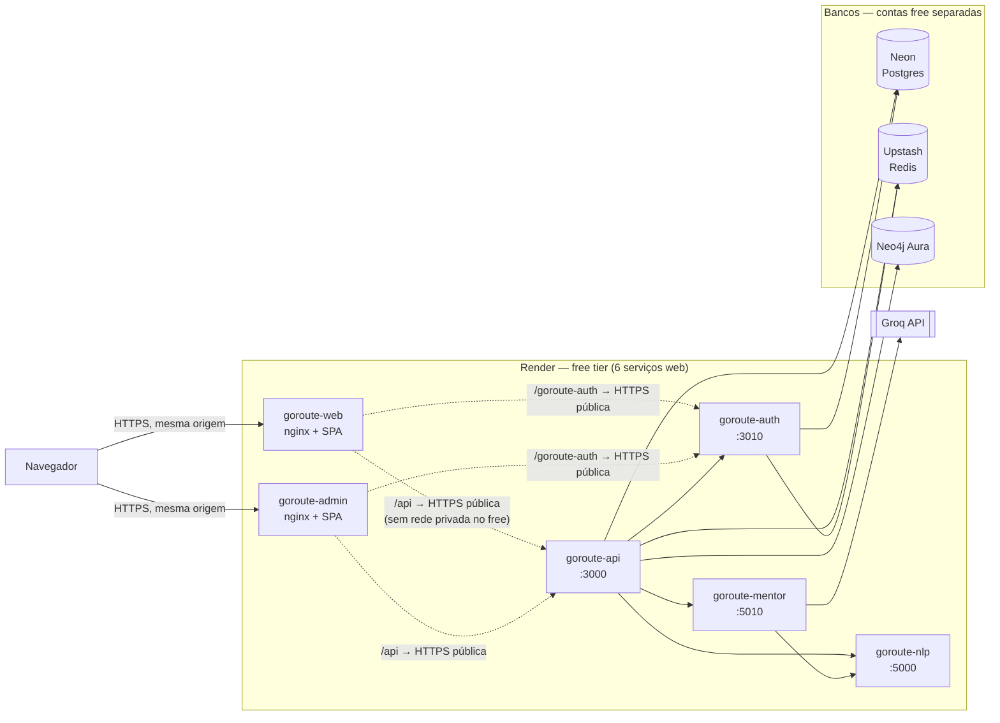
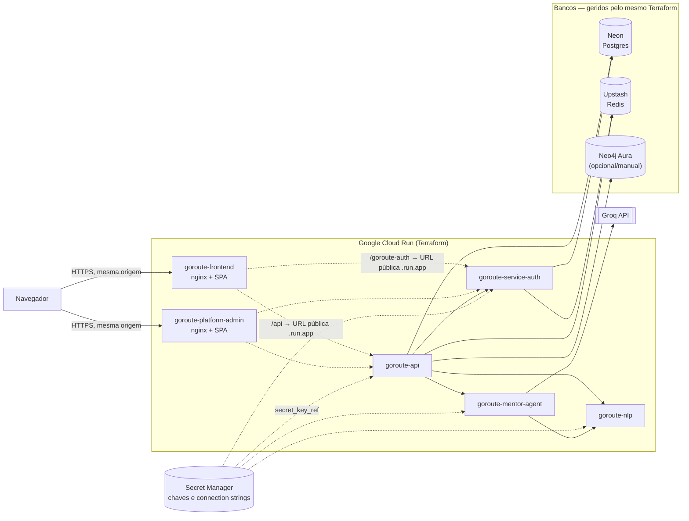

# GoRoute — Deploy

Duas fases: **homologação em free tier** (validar o fluxo todo sem gastar
nada) e **produção** (Terraform, `terraform/`). Este arquivo cobre a
primeira; `terraform/README.md` cobre a segunda.

Nada aqui foi executado ainda — este guia e os arquivos que ele referencia
(`render.yaml`, `nginx.conf.template`, `terraform/`) já estão prontos no
repositório; falta só criar as contas e rodar os passos abaixo quando você
decidir seguir.

## Antes de tudo: segurança

- **`chaves_api.txt` na raiz do repo tem uma chave de API da Groq em texto
  plano.** Apague esse arquivo (ou mova pra fora do repo) e gere uma chave
  nova no console da Groq antes do primeiro `git add` — uma vez commitada,
  uma chave precisa ser considerada vazada mesmo que você apague o arquivo
  depois (fica no histórico do Git).
- Um `.gitignore` na raiz já evita commitar `.env*`, `chaves_api.txt` e os
  arquivos de estado/variáveis do Terraform — confira que ele está presente
  antes do primeiro commit.
- Gere segredos novos para cada ambiente (homolog ≠ produção):
  `openssl rand -hex 32` para `INTERNAL_API_KEY` e
  `MFA_SECRET_ENCRYPTION_KEY`.

## Por que existe um proxy reverso no nginx (`nginx.conf.template`)

O frontend (`goroute-frontend`) e o admin (`goroute-platform-admin`) falam
com a API e o auth por caminhos relativos (`/api`, `/goroute-auth`), e o
cookie de sessão usa `sameSite: 'strict'` + CORS com whitelist fechada (sem
wildcard). Isso só funciona se, do ponto de vista do navegador, tudo parecer
a mesma origem — por isso o próprio nginx de cada SPA faz proxy reverso
dessas rotas para os serviços de backend, em vez do SPA chamar a API/auth
diretamente num domínio diferente. **Não contorne isso** apontando o SPA
direto para a URL da API via `environment.prod.ts` — quebraria os cookies de
sessão (domínios/subdomínios de plataforma como `*.onrender.com`,
`*.fly.dev`, `*.vercel.app` são tratados como "cross-site" entre si, não
"same-site", mesmo sendo subdomínios do mesmo provedor).

Essa é a peça mais delicada do deploy: cada plataforma resolve nomes de host
de um jeito (DNS interno no Compose, 6PN no Fly, nada no Render free), e o
`nginx.conf.template` foi escrito para se adaptar via variáveis de ambiente
sem precisar editar o nginx em si — ver as próximas seções.

## Diagrama das duas versões

**Homologação (Render free tier)** — o ponto chave é que o Render free NÃO
entrega tráfego privado entre serviços, então até dentro da mesma
plataforma o nginx do frontend/admin salta pra URL pública HTTPS de cada
backend (`UPSTREAM_SCHEME=https` + `NGINX_RESOLVER=8.8.8.8`, ver seção da
Opção A):

**Produção (Google Cloud Run via Terraform)** — mesma topologia de
serviços, mas todo segredo vem do Secret Manager (nunca de env var em texto
plano) e o salto do nginx para os backends usa a URL pública `*.run.app`
(Cloud Run não tem variante HTTP interna entre serviços via URL pública,
então o mesmo mecanismo `UPSTREAM_SCHEME=https` da Opção A se aplica aqui
também — ver `cloud_run.tf`):

Diferença prática entre as duas: homologação usa contas free separadas sem
Terraform gerindo os bancos (você cria cada uma manualmente pelo console) e
sem Secret Manager (segredos entram direto como env var `sync: false` no
Render); produção usa o mesmo Terraform pra criar bancos e serviços juntos,
com os segredos centralizados no Secret Manager.

## Opção A (recomendada): Render free tier

Sem cartão, 6 serviços web grátis (até 512MB RAM / 5GB banda por mês cada).
Limitação real: **um serviço web free do Render pode fazer chamada de rede
privada, mas não pode recebê-la** — então o nginx do frontend/admin não
consegue alcançar a API/auth pela rede interna; ele precisa apontar para a
URL pública HTTPS de cada um (`*.onrender.com:443`). Isso já está resolvido
no `render.yaml` e no `nginx.conf.template` via duas variáveis:
`UPSTREAM_SCHEME=https` (troca `http://` por `https://` no `proxy_pass`,
com SNI) e `NGINX_RESOLVER=8.8.8.8` (resolver DNS público, já que não existe
um resolver interno equivalente ao `127.0.0.11` do Compose). Se o Render
mudar essa política no futuro, essas duas variáveis somem do `render.yaml`
e o esquema volta a ser idêntico ao do Compose local.

### Passo a passo

1. **Bancos primeiro** (a URL de conexão de cada um vai nas env vars dos
   serviços no passo 3):
   - [Neon](https://neon.tech) → novo projeto Postgres → crie um banco
     `goroute_auth` → copie a connection string (`postgresql://...`).
   - [Upstash](https://upstash.com) → novo banco Redis (região `us-east-1`
     ou a mais próxima) → copie a URL com TLS (`rediss://...`).
   - [Neo4j Aura](https://console.neo4j.io) → instância Free → copie URI
     (`neo4j+s://...`) e senha.
   - [Groq](https://console.groq.com) → gere uma API key (free tier).
2. Crie o repositório Git (GitHub/GitLab/etc) e suba o código.
3. No [dashboard do Render](https://dashboard.render.com) → **New** →
   **Blueprint** → aponte para o repositório → ele lê `render.yaml` e
   propõe os 6 serviços. Preencha os campos marcados `sync: false`
   (bancos acima + `INTERNAL_API_KEY`/`MFA_SECRET_ENCRYPTION_KEY` gerados
   com `openssl rand -hex 32` + SMTP se for enviar e-mail de verdade).
4. Depois do primeiro deploy, o Render mostra a URL real de cada serviço
   (`https://goroute-web-xxxx.onrender.com`, etc. — o sufixo pode não ser
   exatamente o nome do serviço). Edite as env vars `FRONTEND_URL`,
   `AUTH_PUBLIC_URL`, `AUTH_SERVICE_URL`, `NLP_SERVICE_URL`,
   `MENTOR_AGENT_URL`, `API_UPSTREAM`, `AUTH_UPSTREAM` nos 6 serviços para
   as URLs reais (o `render.yaml` só tem placeholders previsíveis) e
   dispare um **Manual Deploy** em cada um que mudou.
5. **Checklist de verificação**:
   - `https://<goroute-auth>.onrender.com/health` → 200
   - `https://<goroute-api>.onrender.com/api/health` → 200
   - `https://<goroute-web>.onrender.com` abre o SPA
   - Login (e-mail/senha) completa e a sessão persiste ao navegar
   - Primeira requisição depois de ~15 min parado demora 30-50s (serviço
     free "dormiu") — normal, não é erro.

## Opção B: Fly.io (se topar pagar um pouco)

Fly não tem mais free tier contínuo (só um trial de 2h/7 dias) — um app
pequeno sempre ligado fica em torno de US$2-3/mês. Em troca, a rede privada
interna (6PN) funciona de verdade entre os 6 apps, então o
`nginx.conf.template` roda com os defaults originais (HTTP interno, sem o
ajuste de `UPSTREAM_SCHEME`). Os 6 `fly.toml` já estão prontos em cada
pasta de serviço — rode `fly launch --no-deploy` seguido de `fly deploy` em
cada um, na ordem: bancos (Neon/Upstash/Aura, iguais à Opção A) → auth → api
→ nlp → mentor-agent → frontend → admin. Segredos via `fly secrets set`,
nunca no `fly.toml`.

Não usamos o provider Terraform oficial do Fly porque o próprio time da Fly
não o recomenda mais (sem manutenção) — por isso o Terraform de produção
(seção abaixo) mira Google Cloud Run em vez de Fly.

## Depois da homologação: produção

Ver [`terraform/README.md`](./terraform/README.md) — Google Cloud Run (free
tier generoso + provider Terraform oficial e mantido) com Neon/Upstash/Aura
geridos pelo mesmo Terraform (Neo4j Aura fica opcional, por padrão criado
manualmente pelo console). Mentor agent usa Groq free tier nas duas fases
(já é o default do código com `SLM_PROVIDER=hosted`).

## Sobre o domínio

Você ainda não tem domínio — por enquanto use as URLs grátis de cada
plataforma (`*.onrender.com`, `*.fly.dev`, `*.run.app`). Nada na arquitetura
depende de um domínio próprio: quando comprar um, basta mapear o domínio
para o serviço do frontend (`domain-mappings` no Cloud Run, custom domain no
Render) e atualizar `FRONTEND_URL`/`AUTH_PUBLIC_URL`. Login social
(Google/GitHub/etc.) continua desabilitado até existir um domínio estável,
porque cada provedor OAuth exige cadastrar a URL de redirect antecipadamente.
